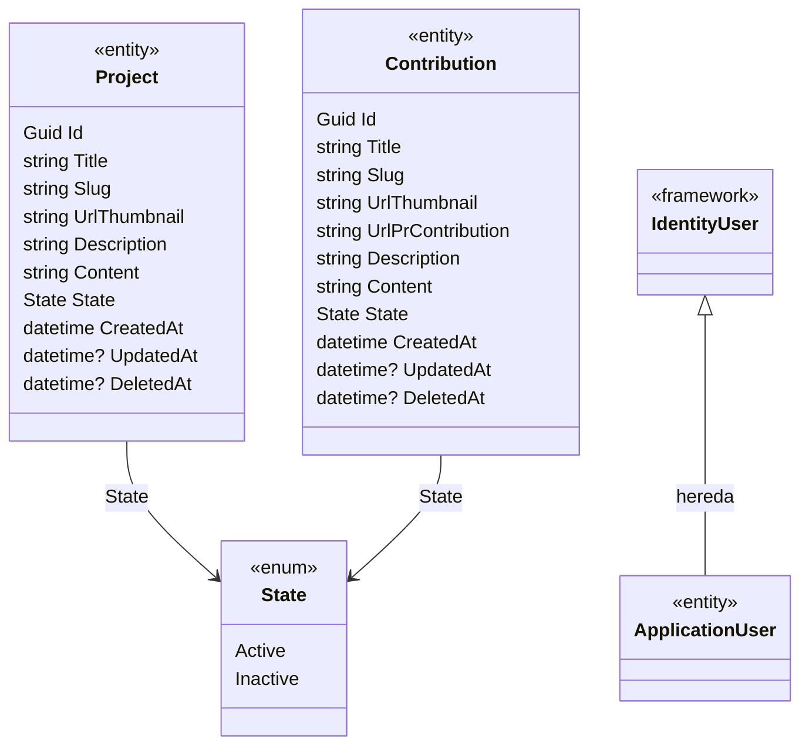

Diagrama de clases del dominio. Refleja el estado actual del código:
`Domain/Entities/Project.cs`, `Domain/Entities/Contribution.cs` y `Domain/Enums/State.cs`.

El enum de estado es `Domain.Enums.State` con los valores `Active` e `Inactive`.
`Project` y `Contribution` lo usan para el estado de publicación; `ApplicationUser`
hereda de `IdentityUser` (ASP.NET Core Identity) y no tiene relación con los proyectos
ni con las contribuciones.

