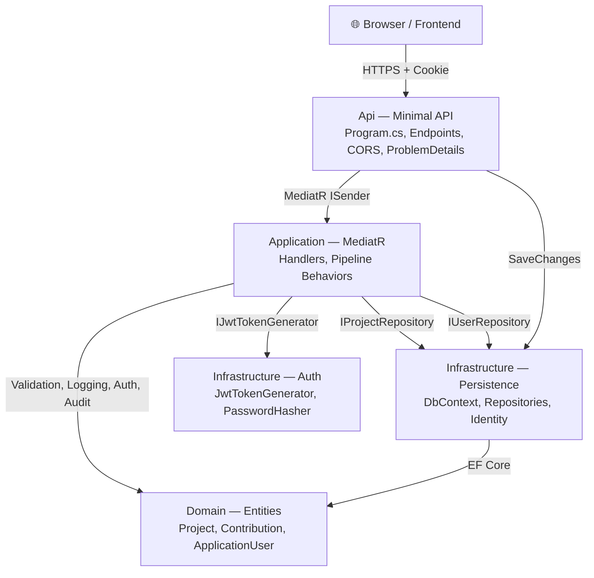
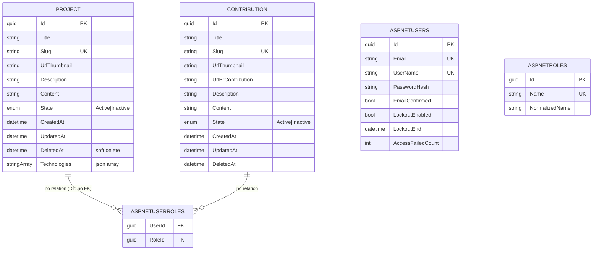

# Architecture Diagram

> This diagram reflects the **current state** of the codebase, not the desired final state.

## Overview



## Request Flow

### Public Read (GET /projects)

```
Browser → DELETE /projects
  → UseHttpsRedirection
  → UseCors("AllowFrontend")
  → UseAuthentication (JwtBearer, reads cookie auth_token)
  → UseAuthorization
  → MapPublicProjectEndpoints
    → GetProjectsQueryHandler
      → IProjectRepository.ListAsync()
        → EF Core → SQLite
      ← Project[] (as DTOs)
    ← Result.Ok(ProjectListDto)
  → 200 OK with {"items":[...], "total":N}
```

### Authenticated Admin Request (POST /admin/projects)

```
Browser → POST /admin/projects
  Cookie: auth_token=<jwt>
  → UseHttpsRedirection
  → UseCors
  → UseAuthentication
    → JwtBearerEvents.OnMessageReceived
      → context.Token = Request.Cookies["auth_token"]
    → JwtSecurityTokenHandler.ValidateToken(token)
    → ClaimsIdentity (sub, email, role=Admin)
  → AuthorizationBehavior
    → RequireAuthorization("AdminOnly")
    → ✅ User is Admin
  → ValidationBehavior
    → CreateProjectCommandValidator
    → ✅ Valid input
  → LoggingBehavior
    → Logs: "Executing CreateProjectCommand"
  → AuditBehavior
    → Logs: "Admin {userId} created project {slug}"
  → CreateProjectCommandHandler
    → IProjectRepository.AddAsync(project)
      → EF Core → SQLite
    ← Result.Success(projectId)
  → 201 Created
```

## Layer Responsibilities

### Api

- HTTP concerns: routing, middleware, CORS, HTTPS redirection
- Maps MediatR `Result<T>` to HTTP responses via `ResultExtensions.ToHttpResult()`
- Does NOT contain business logic or entity manipulation
- Reads configuration from `appsettings.json` / environment variables

**Files**: `Program.cs`, `appsettings*.json`, `Common/CookieHelpers.cs`, `Common/ResultExtensions.cs`, `Endpoints/`

### Application

- Use cases via MediatR handlers
- Pipeline behaviors (cross-cutting concerns)
- DTOs (data transfer objects) — never return entities directly
- Interfaces for infrastructure (repository contracts)

**Files**: `*Handler.cs`, `*Command.cs`, `*Query.cs`, `*Dto.cs`, `Behaviors/`, `Abstractions/`

### Infrastructure

- All implementations of Application interfaces
- Entity Framework Core: DbContext, repositories, migrations
- Identity: UserManager, RoleManager, password hashing
- JWT generation via `JwtSecurityTokenHandler`
- NO business logic — only technical implementation

**Files**: `Persistence/`, `Authentication/`, `DependencyInjection.cs`

### Domain

- Entities with encapsulated business rules
- Enums (e.g., `State` for Project status)
- Value objects (e.g., `TechnologySet`, which owns the rules of the project technologies)
- Validation helpers (used by entity constructors)
- NO dependencies on other layers

**Files**: `Entities/`, `Enums/`, `ValueObjects/`, `Helpers/`

## Dependency Rule

```
Domain ← Application ← Infrastructure ← Api
         (references)   (references)   (references)
```

Api and Infrastructure can reference Application and Domain. Application only references Domain. Domain references nothing else.

## MediatR Pipeline Behavior Order

**Current (in `Application/DependencyInjection.cs`)**

```
Request → AuditBehavior → LoggingBehavior → AuthorizationBehavior → ValidationBehavior → Handler
         ← AuditBehavior ← LoggingBehavior ← AuthorizationBehavior ← ValidationBehavior ←
```

MediatR runs the behaviors in **registration order**: the first one registered is the outermost and therefore runs first. Internally it calls `GetServices(...).Reverse()` and then wraps each behavior around the previous one, so the two reversals cancel out and the net order is the registration order.

**Roadmap specifies** (`docs/roadmap-implementacion.md`)

```
Request → LoggingBehavior → AuthorizationBehavior → ValidationBehavior → AuditBehavior → Handler
```

There is no drift from the roadmap. The implementation matches it on both points that carry a decision:

- **Authorization runs before Validation.** An anonymous caller gets a 401 instead of a 400, so the payload schema of an admin endpoint is not discoverable by unauthenticated probing. It also mirrors how ASP.NET Core itself sequences authentication and authorization before the endpoint body.
- **Logging sits outside both gates**, so every request leaves a trace, including the ones that get rejected.

The implementation goes one step further than the roadmap by putting **Audit outside the gates as well**. The roadmap diagram places `AuditBehavior` innermost, which would mean the audit trail only records commands that were already authorized and valid, and the "failure" branch of `AuditBehavior` would practically never fire. With Audit outermost it records the attempt and its verdict, so rejected attempts stay visible instead of disappearing.

`tests/Application.Tests/Behaviors/PipelineOrderTests.cs` pins this order, so a change of registrations fails the suite instead of silently drifting away from the docs.

## Auth Architecture

```mermaid
sequenceDiagram
    participant Browser
    participant Api
    participant JwtHandler
    participant Identity
    participant Db

    Browser->>Api: POST /admin/auth/login {email, password}
    Api->>Identity: GetByEmailAsync(email)
    Identity->>Db: SELECT * FROM AspNetUsers WHERE Email = ?
    Db-->>Identity: ApplicationUser
    Identity-->>Api: user
    Api->>Identity: CheckPasswordAsync(user, password)
    Identity-->>Api: true/false
    alt Valid credentials
        Api->>JwtHandler: GenerateToken(user)
        JwtHandler-->>Api: JWT signed token
        Api->>Browser: Set-Cookie: auth_token=<jwt>; httpOnly; secure; samesite=strict
        Api-->>Browser: 200 OK
    else Invalid credentials
        Api-->>Browser: 401 Unauthorized
    end
```

## Data Model

### Current Entities



### Relationship Rules

- **D1**: No FK relationship between User and Project/Contribution. The admin is not the "author" of projects.
- **D4**: Single `AppDbContext` extends `IdentityDbContext<ApplicationUser, IdentityRole<Guid>, Guid>`
- **D22**: Project is a **semi-rich domain model** — private setters, public behavior methods (`MarkAsDeleted()`, `Restore()`, `Update()`) and a `TechnologySet` value object that owns the rules of the technologies

## Soft Delete Pattern

```csharp
// Entity method (Domain)
public void MarkAsDeleted() {
    if (DeletedAt is not null) return; // idempotent
    DeletedAt = DateTime.UtcNow;
    UpdatedAt = DateTime.UtcNow;
}

// Repository (Infrastructure)
public async Task<Result> SoftDeleteAsync(Project project, CancellationToken ct) {
    project.MarkAsDeleted();         // domain behavior
    _dbContext.Projects.Update(project);
    await _dbContext.SaveChangesAsync(ct);
    return Result.Success();
}

// Global query filter (Infrastructure)
modelBuilder.Entity<Project>().HasQueryFilter(p => p.DeletedAt == null);
// ^ This hides soft-deleted projects from public queries
// Admin queries use .IgnoreQueryFilters() to see all
```

## Configuration Mapping

```
Environment Variable          → appsettings.json equivalent
─────────────────────────────────────────────────────
ConnectionStrings__DefaultConnection  → ConnectionStrings.DefaultConnection
Jwt__Secret                        → Jwt.Secret
Jwt__Issuer                        → Jwt.Issuer
Jwt__Audience                      → Jwt.Audience
Jwt__ExpirationMinutes             → Jwt.ExpirationMinutes
Bootstrap__Token                   → Bootstrap.Token
Cors__AllowedOrigins               → Cors.AllowedOrigins
```

The double underscore (`__`) maps to nested JSON properties in .NET Configuration.
