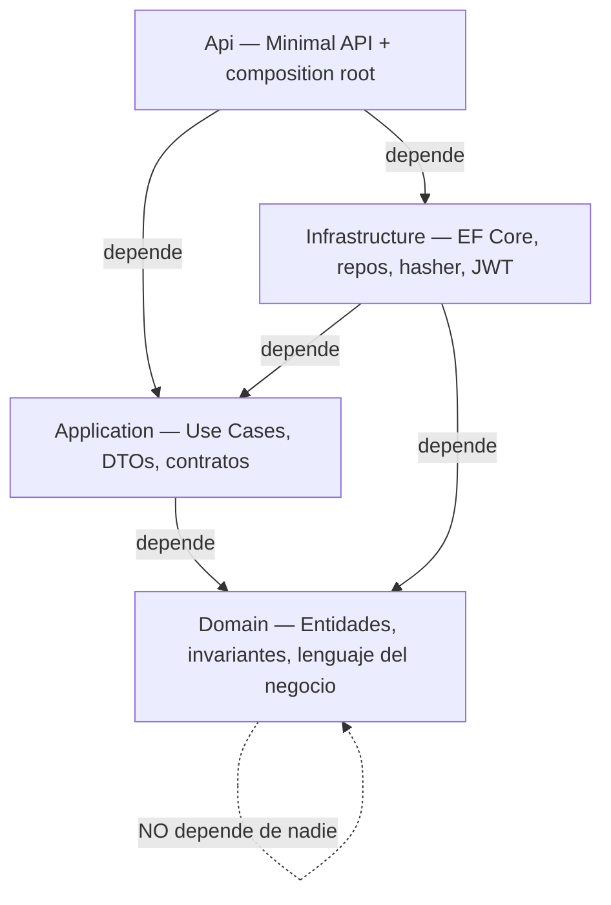

# Roadmap de Implementación — Portfolio Backend (Clean Architecture)

> Documento vivo. Cada fase es una unidad ejecutable por **un único agente** con scope cerrado, criterios de aceptación explícitos y dependencias claras de la fase anterior.

---

## TL;DR

Se está construyendo una **Minimal API en .NET 10 con Clean Architecture en 4 capas** para exponer un portfolio público de proyectos. La fase actual del repo es solo `Domain` con dos entidades (`Project`, `User`). Las 11 fases que siguen llevan hasta una API corriendo con dos endpoints `GET`, datos sembrados, EF Core configurado y tests desde el día 1.

**Lo que NO entra en este roadmap** (queda para fases futuras):
- Autenticación / autorización (JWT, login, roles).
- Comandos de escritura (`POST/PUT/DELETE` de proyectos).
- Frontend (Astro SSR en repo separado).

**Supuestos cerrados** (ver § Decisiones Arquitectónicas): sin relación `User ↔ Project`, sin auth por ahora, use cases tradicionales (sin MediatR), un único `AppDbContext`.

---

## Índice de Fases

| # | Fase | Depende de | Output verificable |
|---|------|------------|--------------------|
| 0 | Mental model & arquitectura | — | Diagrama mental de las 4 capas en la cabeza |
| 1 | Ajustar el Domain | F0 | `dotnet build` verde, `IRepository<T>` eliminado |
| 2 | Diagrama de clases del dominio | F1 | `docs/diagrams/domain-class-diagram.md` |
| 3 | Application: abstracciones de infraestructura | F1 | Proyecto `Application/` compila |
| 4 | Application: DTOs | F3 | DTOs compilan, son `record` |
| 5 | Application: Use Cases | F3, F4 | Use cases + tests unitarios verdes |
| 6 | Infrastructure: EF Core & migraciones | F1 | `dotnet ef database update` crea DB con seed |
| 7 | Infrastructure: repositorios concretos | F3, F6 | `ProjectRepository` implementa la interfaz |
| 8 | Infrastructure: composition root | F6, F7 | `AddInfrastructure(...)` registra todo |
| 9 | Api: Minimal API & endpoints | F4, F5, F8 | `curl localhost:5000/projects` responde JSON |
| 10 | Tests de integración | F9 | `WebApplicationFactory` verde |
| 11 | Diagrama de clases final & housekeeping | F2, F10 | `docs/diagrams/architecture.md` + `README.md` |

Cada fase es ejecutada por **un agente con scope cerrado** (ver § Contrato del agente al final del documento).

---

## Decisiones Arquitectónicas Cerradas

| # | Decisión | Elegido | Por qué | Trade-off conocido |
|---|----------|---------|---------|--------------------|
| D1 | Relación `User ↔ Project` | Portfolio anónimo, sin FK | El DER actual no tiene FK y el dominio no lo requiere | Cuando se agregue Auth, no hay base autoral para reutilizar |
| D2 | Alcance de auth | Solo lectura pública por ahora | Reduce superficie, permite enfocar en arquitectura | Endpoints de admin y mutaciones quedan para fase futura |
| D3 | Patrón de Use Case | Clase tradicional con método `ExecuteAsync` | Sin framework externo, más explícito, mejor para aprender | Más boilerplate que CQRS+MediatR |
| D4 | DbContext | Un único `AppDbContext` | Suficiente para 2 agregados chicos; menos complejidad | Si el dominio crece, división por agregado requiere migración |
| D5 | Persistencia dev | SQLite (archivo local) | Cero setup, coincide con el runbook original | Provider distinto al de prod (PostgreSQL) — los flujos deben ser compatibles con ambos |
| D6 | Persistencia prod | PostgreSQL 15 (Turso/Render) | Decisión previa del proyecto | — |
| D7 | Manejo de errores | `Result<T>` tipado en Application, `ProblemDetails` en API | Flujo explícito de éxito/fallo sin excepciones de control | Hay que implementar un mapper `Result → IResult` |
| D8 | Validación de input | DataAnnotations en DTOs de entrada (cuando existan) | Built-in, sin paquete extra | No hay reglas compuestas; cuando aparezcan, migrar a FluentValidation |
| D9 | Versionado del código | Conventional Commits + ramas `feature/`, `fix/`, `refactor/`, `chore/`, `docs/` | Ya estaba en `CONTRIBUTING.md` (borrado); se mantiene | — |
| D10 | Target framework | `net10.0` | Ya estaba en `Domain.csproj` | — |

---

## Arquitectura: las 4 capas



**Regla de dependencia (la única regla de oro):** las flechas apuntan al centro. `Domain` no conoce a nadie; `Application` solo conoce `Domain`; `Infrastructure` y `Api` conocen todo y son las únicas capas que tocan el mundo exterior (DB, HTTP, secrets, clock, etc.).

### Qué vive en cada capa

| Capa | Contiene | NO contiene |
|------|----------|-------------|
| `Domain` | Entidades, value objects, invariantes del negocio, factories | Interfaces de repos, EF Core, HTTP, DTOs, librerías externas |
| `Application` | Use cases (Commands y Queries), DTOs, contratos de `IProjectRepository`, `IJwtTokenGenerator`, `IUnitOfWork`, validación de input | EF Core, `DbContext`, HttpContext, secrets, implementaciones concretas |
| `Infrastructure` | `AppDbContext`, configuraciones de EF, migraciones, `ProjectRepository`, `UserRepository`, `PasswordHasher`, `JwtTokenGenerator`, `Clock`, migraciones y seed | Use cases, DTOs, lógica de negocio |
| `Api` | `Program.cs` (composition root), endpoints minimal, middleware, OpenAPI/Swagger, Problem Details, configuración | Entidades de dominio directamente, lógica de negocio propia |

### Analogía (para grabar el modelo mental)

| Capa | Analogía | Puede ser ignorada por… |
|------|----------|--------------------------|
| `Domain` | La estructura de tu casa: paredes, cimientos, reglamento de copropiedad | El plomero (Infrastructure) puede entrar y modificar, pero no romper paredes |
| `Application` | El manual del usuario: "qué necesita el cliente" | La casa no sabe del manual; el manual llama a la casa |
| `Infrastructure` | Las instalaciones (caños, cables, ruta de USPS) | Reemplazables sin tocar la casa, mientras respete los manuales |
| `Api` | La puerta de entrada y el timbre | Quien está adentro no sabe de quién toca |

---

## Convenciones Globales (aplican a TODAS las fases)

### Naming C#

```csharp
public class ProjectService { }            // PascalCase, una clase por archivo
public interface IProjectRepository { }    // I + PascalCase
public Project GetBySlug(string slug) { }  // PascalCase en métodos
public const int MaxProjectsPerPage = 100; // PascalCase en constantes (NO SCREAMING_SNAKE)
private readonly IProjectRepository _r;    // _camelCase en campos privados
```

### Async/Await

```csharp
// SIEMPRE async en métodos que tocan I/O
public async Task<Project?> GetBySlugAsync(string slug, CancellationToken ct = default);
```

Regla: si el método devuelve `Task` o `Task<T>`, el nombre **siempre** termina en `Async`. Sin `.Result` ni `.Wait()`.

### Errores

```csharp
// Aplicación: Result<T> explícito
public sealed record Result<T>
{
    public T? Value { get; }
    public Error? Error { get; }
    public bool IsSuccess => Error is null;
}

// Api: RFC 7807 Problem Details (built-in en ASP.NET Core)
return Results.Problem(detail: "...", statusCode: 404, title: "Project not found");
```

### Inyección de dependencias

| Servicio | Lifetime | Justificación |
|----------|----------|---------------|
| `AppDbContext` | `Scoped` | Una instancia por request (maneja la unidad de trabajo) |
| Repositorios | `Scoped` | Comparten el `DbContext` dentro del request |
| Use cases (handlers) | `Scoped` o `Transient` | Stateless; ambos válidos |
| Servicios cross-cutting (clock, hasher, JWT) | `Singleton` o `Scoped` | Stateless → Singleton es válido |

### Tests

- Framework: **xUnit**.
- Assertions: **FluentAssertions** (legibilidad > magic strings).
- Mocks/fakes para repositorios: **NSubstitute** (más limpio que Moq) o **fakes hechos a mano** para aprender.
- Naming: `MethodName_WhenCondition_ThenExpectedResult`.

### Commits

```bash
feat(application): add GetProjectsQuery handler
test(application): cover GetProjectBySlugHandler not-found path
chore(deps): add microsoft.entityframeworkcore.sqlite 10.x
```

### Qué NO hacer en NINGUNA fase

- ❌ Devolver entidades de `Domain` desde los endpoints (siempre vía DTO).
- ❌ Usar `DbContext` fuera de `Infrastructure`.
- ❌ Inyectar `IServiceCollection` o `IConfiguration` en clases de `Application` o `Domain`.
- ❌ Crear dependencias circulares entre proyectos.
- ❌ `Task.Run` para "paralelizar" código que ya es async (rompe el sync context).

---

## Contrato del agente (aplica a F1–F11)

Cada fase es ejecutada por **un solo agente**, lanzado con scope cerrado. Este contrato es ley para los 11 agentes.

### Qué puede hacer
- Crear, modificar o eliminar archivos **explícitamente listados** en la sección "Archivos a tocar" de su fase.
- Agregar paquetes NuGet listados en la sección "Paquetes" de su fase.
- Crear tests en los proyectos de test listados en la fase.

### Qué NO puede hacer
- Tocar archivos de fases anteriores que no estén en su scope (crea diff huérfanos).
- Cambiar decisiones cerradas (D1–D10). Si encuentra conflicto, **detenerse y preguntar**, no resolver.
- Saltarse el checkpoint. Si no compila o los tests no pasan, la fase no se cierra.
- Tocar `README.md` salvo en F11.

### Output obligatorio al cerrar la fase
1. Lista de archivos creados / modificados / eliminados con una línea de razón por archivo.
2. Resultado de `dotnet build` y `dotnet test` (copy-paste de la salida).
3. Conventional commit escrito pero **sin commitear** (lo commitea el humano).

### Cómo se invoca
Cada fase incluye una sección "Prompt del agente" lista para copiar/pegar en un `Task` con `subagent_type: sdd-apply` (o `general`). El prompt fija el scope y exige leer esta sección del roadmap antes de actuar.

---

## FASE 0 — Mental model & arquitectura

**Objetivo:** que la persona tenga internalizadas las 4 capas, la regla de dependencia, y la responsabilidad de cada capa. No se toca código.

**Duración estimada:** 30–60 minutos (lectura + dibujo a mano).

**Depende de:** nada.

**Concepto teórico:**
1. **Capas técnicas vs Clean Architecture.** En capas técnicas, separás por tipo técnico (`Services/`, `Controllers/`, `Repositories/`) y todo vive dentro del mismo proyecto. En Clean Architecture, separás por **dirección de dependencia**: el dominio está al centro y nada lo toca desde fuera sin pasar por los anillos correctos.
2. **La regla de dependencia.** El sentido de las dependencias es siempre **hacia el centro**. Lo que está más cerca del negocio no sabe de la tecnología. Esto permite cambiar Infrastructure (PostgreSQL → Mongo) sin tocar Application ni Domain.
3. **Screaming Architecture.** Cuando abrís la carpeta `src/Projects/`, debería gritar "ESTO ES UN SISTEMA DE PROYECTOS", no "ESTO ES UN SISTEMA CON REPOSITORIOS, SERVICIOS Y CONTROLADORES". Las features del negocio viven en primer plano.
4. **Inversión de dependencias.** El Use Case depende de `IProjectRepository` (interfaz en Application), no de `ProjectRepository` (clase en Infrastructure). Esto es inversión de dependencias (letra D de SOLID) y es la que hace posible el testing sin DB.

**Tarea concreta:**
1. Releer este documento y la tabla "Qué vive en cada capa".
2. Dibujar a mano (papel o pizarra) las 4 capas con las flechas de dependencia.
3. Pintar mentalmente cada archivo nuevo del proyecto del color de su capa. Si te queda del mismo color que una capa distinta, repensar.

**Checkpoint:**
- [ ] Podés dibujar de memoria las 4 capas en cualquier orden.
- [ ] Podés responder "dónde vive el DbContext" y "dónde vive el DTO" sin dudar.
- [ ] Podés explicar en una frase la diferencia entre capas técnicas y Clean Architecture.

**Output esperado:** ninguno (es solo lectura + dibujo mental). Cuando se cumple el checkpoint, se pasa a F1.

---

## FASE 1 — Ajustar el Domain

**Objetivo:** dejar `Domain` limpio para Clean Architecture: nada que dependa de EF Core, nada de interfaces genéricas anémicas. Preparar el terreno para `Application`.

**Duración estimada:** 1–2 horas.

**Depende de:** F0.

**Concepto teórico:**
- **Por qué `IRepository<TEntity, TId>` genérico es limitado.** Expresa "soy un CRUD genérico", no "soy un repositorio de proyectos". Cuando crece el dominio, perdés el lenguaje. Las interfaces específicas (`IProjectRepository` con `GetBySlugAsync`) son más fáciles de mockear, leer y extender.
- **Dónde viven las interfaces.** Una interfaz **de qué necesita la capa que la usa**, no de qué la implementa. Por eso las interfaces de repo van en `Application` (la capa que las necesita), no en `Domain` (que no las necesita).
- **Entidades ricas vs anémicas.** El `Project.cs` actual ya es rico (setters privados, validación, métodos de comportamiento). Eso se mantiene.

**Estado inicial:**
- `Domain/Entities/Project.cs` con setters privados, validaciones en constructor, métodos `SetActive/SetInactive`.
- `Domain/Entities/User.cs` idem.
- `Domain/Abstractions/IRepository.cs` con CRUD genérico.
- `Domain/Domain.csproj` apuntando a `net10.0`.

**Archivos a tocar:**

| Acción | Path | Razón |
|--------|------|-------|
| Eliminar | `Domain/Abstractions/IRepository.cs` | La abstracción genérica se reemplaza por interfaces específicas en Application |
| Mantener | `Domain/Entities/Project.cs` | Entidad rica, ya cumple el patrón |
| Mantener | `Domain/Entities/User.cs` | Entidad rica (sin uso inmediato pero lista para futura Auth) |
| Crear | `docs/diagrams/` | Carpeta ya existe; F2 la usa |

**Firmas esperadas:** ninguna nueva. Solo se elimina un archivo.

**Decisiones a tomar:**
- **D1.1 — Value Objects.** ¿Extraer `Email` y `Slug` como Value Objects en `Domain/ValueObjects/`? Pro: validación embebida, no se puede construir un `Project` con slug inválido. Contra: más archivos, hay que mapear en EF. Si vas a aprender, **recomendado SÍ**. Si querés minimalismo, **NO por ahora**.
- **D1.2 — Validación del Slug en el constructor.** ¿Validar regex `^[a-z0-9-]+$` en `Project` o delegar al Use Case de creación (cuando exista)? Si D1.1 es SÍ, el VO se encarga. Si D1.1 es NO, la validación queda en el constructor.

**Errores comunes:**
- ❌ Mover `IRepository` a `Application/Abstractions/Persistence/` en esta fase. **Esa es F3.** Esta fase solo borra.
- ❌ Agregar paquetes a `Domain` (debe quedar sin dependencias externas).
- ❌ Sacar los setters privados "porque molestan". Son el pilar de la entidad rica.
- ❌ Cambiar el nombre de `ProjectState` a `EstadoProyecto`. El dominio se escribe en inglés.

**Scope del agente:**
- ✅ Puede: eliminar `IRepository.cs`, modificar entidades **solo para lo acordado en D1.1**, agregar `Domain/ValueObjects/` si D1.1 = SÍ.
- ❌ NO puede: tocar `Application/`, `Infrastructure/`, `Api/` (todavía no existen — si los tiene que crear, **detenerse y preguntar**).
- ❌ NO puede: agregar EF Core, NuGet packages, ni nada externo a `Domain`.

**Checkpoint:**
- [ ] `dotnet build` desde la raíz sigue verde.
- [ ] `Domain/Abstractions/` está vacío o solo tiene archivos cuya razón de existir esté justificada.
- [ ] Las entidades siguen teniendo setters privados y validación en el constructor.
- [ ] Si D1.1 = SÍ, los VO compilan y son inmutables (`record class` o `sealed record`).

**Prompt del agente** (copiar y adaptar):
```
Tarea: ejecutar FASE 1 del archivo docs/roadmap-implementacion.md.
Scope: SOLO el proyecto Domain. NO crear Application, Infrastructure ni Api.
Pasos:
  1. Lee docs/roadmap-implementacion.md sección "FASE 1".
  2. Aplica las decisiones D1.1 y D1.2 que ya están cerradas con el usuario.
  3. Reportá: archivos tocados (ruta + razón de una línea), salida de `dotnet build`.
```

**Output esperado:**
- Diff que muestre: archivos eliminados / creados / modificados con razones de una línea.
- Salida de `dotnet build` (sin warnings).
- Mensaje de commit: `refactor(domain): drop generic IRepository in favor of feature-specific contracts (move to application)` o el equivalente según lo que efectivamente cambió.

---

## FASE 2 — Diagrama de clases del dominio

**Objetivo:** documentar visualmente qué hay hoy en `Domain` para tener una referencia cuando se agreguen Application/Infra/Api.

**Duración estimada:** 30–60 minutos.

**Depende de:** F1 (el dominio debe estar estabilizado antes de dibujarlo).

**Concepto teórico:**
- **Class diagram vs ER diagram.** El ER muestra tablas; el class diagram muestra **comportamiento** (métodos, validaciones, invariantes) además de campos. Sirve para comunicar el modelo de objetos, no el esquema de DB.
- **Qué entra y qué no.** Entran: clases con nombre, campos relevantes, métodos públicos que cambian estado, relaciones de asociación/agregación. **No** entran: getters/setters triviales, propiedades auto-generadas por ORM, métodos privados de validación.
- **Mermaid `classDiagram`:** sintaxis estricta; no renderiza notas largas mejor que un párrafo corto por línea.

**Estado inicial:** `Domain` quedó como resultado de F1 (entidades + VO si D1.1=SÍ).

**Archivos a tocar:**

| Acción | Path | Razón |
|--------|------|-------|
| Crear | `docs/diagrams/domain-class-diagram.md` | Documentar visualmente el dominio estabilizado |

**Contenido esperado del archivo:**

- Frontmatter con fecha y autor.
- Sección "Cómo leer este diagrama".
- ` ```mermaid ` con `classDiagram` que muestre:
  - `Project` con `Id`, `Title`, `Slug`, `UrlThumbnail`, `Description`, `Content`, `State` (enum), `CreatedAt`, `UpdatedAt`, `DeletedAt`.
  - Métodos públicos de `Project`: `SetActive()`, `SetInactive()`, constructor principal.
  - `User` con `Id`, `PasswordHash`, `Email`.
  - Si D1.1=SÍ: VO `Email` y `Slug` con sus métodos de fábrica/validación.
  - **No** mostrar relaciones entre `Project` y `User` (D1: sin FK).

**Decisiones a tomar:**
- **D2.1 — Visibilidad.** ¿Mostrar todos los campos como `+` (públicos)? Recordá que en C# hay propiedades, no campos. Mostralas como `+Title: string` aunque el setter sea privado; en el diagrama lo que importa es la forma del modelo.
- **D2.2 — Métodos privados.** No se muestran. Si el comportamiento es importante, documentar en una nota aparte.

**Errores comunes:**
- ❌ Incluir getters/setters (`+get_Id()`, `+set_Title(v)`). El diagrama **no es un dump de la API de reflection**.
- ❌ Agregar navegación a `User` desde `Project` para "prever el futuro". Hoy la relación no existe.
- ❌ Mezclar con el ER de `DER - Portfolio.md`. Son documentos distintos con propósitos distintos.

**Scope del agente:**
- ✅ Puede: crear `docs/diagrams/domain-class-diagram.md`.
- ❌ NO puede: tocar el código de `Domain/`.

**Checkpoint:**
- [ ] El archivo existe y renderiza correctamente en cualquier visualizador Mermaid.
- [ ] Refleja **fielmente** el código actual (no el deseado).
- [ ] No muestra métodos privados ni getters/setters.

**Prompt del agente:**
```
Tarea: ejecutar FASE 2 de docs/roadmap-implementacion.md.
Scope: SOLO docs/diagrams/domain-class-diagram.md. NO tocar código.
Pasos:
  1. Lee el código actual de Domain/.
  2. Genera docs/diagrams/domain-class-diagram.md con Mermaid classDiagram fiel al código.
  3. Reportá: archivo creado + confirmación de que no tocaste código.
```

---

## FASE 3 — Application: abstracciones de infraestructura

**Objetivo:** que `Application` declare todas las interfaces que necesita (repositorios, contratos auxiliares) sin saber cómo se implementan. Es la **primera capa que depende de `Domain`**.

**Duración estimada:** 1–2 horas.

**Depende de:** F1.

**Concepto teórico:**
- **Las interfaces de repo NO viven en `Domain`.** Es un error clásico. Si vivieran en `Domain`, `Domain` terminaría arrastrando convenciones del ORM. La interfaz refleja **lo que la capa que la usa necesita**; por eso vive en `Application/Abstractions/Persistence/`.
- **Unit of Work vs SaveChanges en cada repo.** Con EF Core, el `DbContext` ya es la unidad de trabajo. El repo concreto usualmente **no** expone `SaveChangesAsync`; lo hace el handler del Use Case al final.

**Estado inicial:**
- `Application/` no existe.
- Solución solo contiene `Domain`.

**Archivos a tocar:**

| Acción | Path | Razón |
|--------|------|-------|
| Crear | `Application/Application.csproj` | Nuevo proyecto, referencia a `Domain` |
| Crear | `Application/Abstractions/Persistence/IProjectRepository.cs` | Interfaz específica del agregado Project |
| Crear | `Application/Abstractions/Persistence/IUserRepository.cs` | Interfaz (sin uso inmediato; lista para futura Auth) |
| Crear | `Application/Abstractions/Persistence/IUnitOfWork.cs` | Para confirmar cambios al final de un Use Case |
| Modificar | `ajn-portfolio-backend.slnx` | Agregar el nuevo proyecto a la solución |
| Modificar | `Domain/Domain.csproj` | Sin cambios de paquetes; solo se referencia desde `Application` |

**Firmas esperadas:**

```csharp
// Application/Abstractions/Persistence/IProjectRepository.cs
public interface IProjectRepository
{
    Task<Project?> GetByIdAsync(Guid id, CancellationToken ct = default);
    Task<Project?> GetBySlugAsync(string slug, CancellationToken ct = default);
    Task<IReadOnlyList<Project>> ListAsync(CancellationToken ct = default);
    Task AddAsync(Project project, CancellationToken ct = default);
    Task UpdateAsync(Project project, CancellationToken ct = default);
    Task RemoveAsync(Project project, CancellationToken ct = default);
}

// Application/Abstractions/Persistence/IUserRepository.cs
public interface IUserRepository
{
    Task<User?> GetByIdAsync(Guid id, CancellationToken ct = default);
    Task<User?> GetByEmailAsync(string email, CancellationToken ct = default);
    Task<bool> ExistsByEmailAsync(string email, CancellationToken ct = default);
    Task AddAsync(User user, CancellationToken ct = default);
}

// Application/Abstractions/Persistence/IUnitOfWork.cs
public interface IUnitOfWork
{
    Task<int> SaveChangesAsync(CancellationToken ct = default);
}
```

**Decisiones a tomar:**
- **D3.1 — `IUnitOfWork` sí o no.** EF Core ya provee unidad de trabajo vía `DbContext`. La pregunta es si querés **abstraer** el `SaveChanges` para que Application no conozca EF. Pro: Application es testeable sin EF. Contra: doble indirección. **Recomendado: SÍ**, porque es lo que hace que los tests de Application no necesiten mocks de EF.
- **D3.2 — ¿Exponer `IQueryable<T>`?** No. Los filtros los hace el repo; el caller pide cosas, no filtra tablas.

**Errores comunes:**
- ❌ Poner las interfaces en `Domain/Abstractions/` "porque suena más pro". **NO.**
- ❌ Agregar `IQueryable` a la interfaz "para flexibilidad". Filtrar en el repo siempre.
- ❌ Hacer que la interfaz devuelva `IEnumerable<T>` cuando podría devolver `IReadOnlyList<T>` (más preciso).
- ❌ Olvidar el `CancellationToken` por defecto. Es una convención del proyecto.

**Scope del agente:**
- ✅ Puede: crear `Application/`, modificar la `.slnx`, agregar la referencia `Domain` en `Application.csproj`.
- ❌ NO puede: tocar `Domain/`, crear `Infrastructure/`, instalar EF Core (todavía no toca).
- ❌ NO puede: implementar las interfaces (eso es F7).

**Checkpoint:**
- [ ] `dotnet build` desde la raíz sigue verde.
- [ ] `Application.csproj` tiene `<ProjectReference Include="../Domain/Domain.csproj" />`.
- [ ] La solución incluye ambos proyectos.
- [ ] Las interfaces usan `CancellationToken = default` en todos los métodos async.

**Prompt del agente:**
```
Tarea: ejecutar FASE 3 de docs/roadmap-implementacion.md.
Scope: crear SOLO el proyecto Application y sus abstracciones de persistencia.
Pasos:
  1. Lee la sección FASE 3 completa.
  2. Crea los archivos listados con las firmas esperadas.
  3. Actualiza la slnx.
  4. Reportá: archivos tocados, salida de dotnet build.
```

---

## FASE 4 — Application: DTOs

**Objetivo:** que `Application` tenga DTOs para entrada y salida de los Use Cases. Acá se ve el modelo de UI antes de tocar endpoints.

**Duración estimada:** 1 hora.

**Depende de:** F3.

**Concepto teórico:**
- **Entity ≠ DTO.** La entidad es el modelo de negocio (con invariantes, comportamiento). El DTO es el contrato hacia afuera (lo que recibe/responde la API). Mezclar = acoplar el dominio a la API.
- **`record` inmutable.** Los DTOs son `record` porque no mutan: nacen de un request o se construyen para una respuesta. `init`-only properties refuerzan la inmutabilidad.
- **Listado vs Detalle.** Un DTO de listado suele ser "ligero" (sin `Content`, sin timestamps) y uno de detalle trae todo. Pensar UI primero define la forma del DTO.

**Estado inicial:** `Application/` existe con las abstracciones de F3.

**Archivos a tocar:**

| Acción | Path | Razón |
|--------|------|-------|
| Crear | `Application/Projects/Dtos/ProjectSummaryDto.cs` | DTO para listados |
| Crear | `Application/Projects/Dtos/ProjectDetailDto.cs` | DTO para detalle |
| Crear | `Application/Projects/Dtos/ProjectListDto.cs` | DTO envolvente con paginación |
| Crear | `Application/Abstractions/Common/Result.cs` | Tipo `Result<T>` para éxito/fallo tipados |

**Firmas esperadas:**

```csharp
// Application/Projects/Dtos/ProjectSummaryDto.cs
public sealed record ProjectSummaryDto(
    Guid Id,
    string Slug,
    string Title,
    string UrlThumbnail,
    string Description);

// Application/Projects/Dtos/ProjectDetailDto.cs
public sealed record ProjectDetailDto(
    Guid Id,
    string Slug,
    string Title,
    string UrlThumbnail,
    string Description,
    string Content,
    string State,                  // Enum serializado como string en JSON
    DateTime CreatedAt,
    DateTime? UpdatedAt);

// Application/Projects/Dtos/ProjectListDto.cs
public sealed record ProjectListDto(
    IReadOnlyList<ProjectSummaryDto> Items,
    int Total,
    int Page,
    int PageSize);

// Application/Abstractions/Common/Result.cs
public sealed record Result<T>(T? Value, Error? Error)
{
    public bool IsSuccess => Error is null;
    public bool IsFailure => Error is not null;
    public static Result<T> Success(T value) => new(value, null);
    public static Result<T> Failure(Error error) => new(default, error);
}

public sealed record Error(string Code, string Message);
```

**Decisiones a tomar:**
- **D4.1 — `State` como string en el DTO.** Acepto que sea `string` (nombre del enum) en lugar de `int` para que el JSON sea legible. Si D1.1=SÍ con VO, podrías usar el VO directamente. **Recomendado: `string`** (más portable entre versiones).
- **D4.2 — Paginación en `ProjectListDto`.** ¿Devolvemos `Total`, `Page`, `PageSize`, o solo `Items`? **Recomendado: las cuatro**, porque la UI casi siempre quiere saber "hay más".
- **D4.3 — DTOs de entrada por ahora vacíos.** Como no hay Commands, no hay `CreateProjectDto` en esta fase. Cuando llegue Auth+Commands, se crea en una nueva fase.

**Errores comunes:**
- ❌ Devolver la entidad `Project` "porque ya tiene todo". El día que agregues un campo privado o un cálculo interno, se filtra a la API.
- ❌ Usar `class` en lugar de `record`. Los DTOs son datos planos, inmutables.
- ❌ Olvidar `IReadOnlyList<>` y usar `List<>` (que es mutable).
- ❌ Poner los DTOs en `Api/`. Son parte del contrato de Application.

**Scope del agente:**
- ✅ Puede: crear los archivos listados en `Application/`.
- ❌ NO puede: tocar nada de `Domain/`, `Infrastructure/`, `Api/`.

**Checkpoint:**
- [ ] Los DTOs compilan.
- [ ] Todos son `record` o `sealed record`.
- [ ] `Result<T>` es genérico y permite construir éxito/fallo sin métodos custom por Use Case.

**Prompt del agente:**
```
Tarea: ejecutar FASE 4 de docs/roadmap-implementacion.md.
Scope: SOLO archivos en Application/.
Pasos:
  1. Lee la sección FASE 4 completa.
  2. Crea los DTOs y Result<T> con las firmas esperadas.
  3. Reportá: archivos tocados, salida de dotnet build.
```

---

## FASE 5 — Application: Use Cases

**Objetivo:** que existan los dos Queries (`GetProjectsQuery`, `GetProjectBySlugQuery`) con sus handlers, mapeos a DTOs, y tests unitarios con un fake `IProjectRepository`.

**Duración estimada:** 2–3 horas.

**Depende de:** F3, F4.

**Concepto teórico:**
- **Un Use Case = una intención del usuario**, no una operación CRUD. `GetProjectsQuery` y `GetProjectBySlugQuery` son dos intenciones distintas aunque en el fondo sean dos selects.
- **Mapeo a DTO.** El handler hace `Project → ProjectSummaryDto`. El mapeo puede ser explícito (factory method en el DTO) o con un mapper automático (Mapster, AutoMapper). **Recomendado: factory en el DTO** para mantener Application libre de librerías de mapeo.
- **Tests con fakes.** Un `FakeProjectRepository` (clase que implementa la interfaz con un `List<Project>` interno) es más claro y menos frágil que un mock. Moq/NSubstitute se justifican cuando la interfaz es enorme.

**Estado inicial:** `Application/` tiene abstracciones (F3) y DTOs (F4).

**Archivos a tocar:**

| Acción | Path | Razón |
|--------|------|-------|
| Crear | `tests/Application.Tests/Application.Tests.csproj` | Proyecto de tests |
| Crear | `tests/Application.Tests/Fakes/FakeProjectRepository.cs` | Fake para tests |
| Crear | `tests/Application.Tests/GetProjectsQueryHandlerTests.cs` | Tests del listado |
| Crear | `tests/Application.Tests/GetProjectBySlugQueryHandlerTests.cs` | Tests del detalle |
| Crear | `Application/Projects/Queries/GetProjects/GetProjectsQuery.cs` | Query inmutable |
| Crear | `Application/Projects/Queries/GetProjects/GetProjectsQueryHandler.cs` | Handler |
| Crear | `Application/Projects/Queries/GetProjectBySlug/GetProjectBySlugQuery.cs` | Query |
| Crear | `Application/Projects/Queries/GetProjectBySlug/GetProjectBySlugQueryHandler.cs` | Handler |
| Modificar | `ajn-portfolio-backend.slnx` | Agregar el proyecto de tests |

**Firmas esperadas:**

```csharp
// Application/Projects/Queries/GetProjects/GetProjectsQuery.cs
public sealed record GetProjectsQuery(int Page = 1, int PageSize = 20);

// Application/Projects/Queries/GetProjects/GetProjectsQueryHandler.cs
public sealed class GetProjectsQueryHandler
{
    public GetProjectsQueryHandler(IProjectRepository repo, IUnitOfWork uow) { ... }
    public Task<Result<ProjectListDto>> HandleAsync(GetProjectsQuery query, CancellationToken ct = default);
}

// Application/Projects/Queries/GetProjectBySlug/GetProjectBySlugQuery.cs
public sealed record GetProjectBySlugQuery(string Slug);

// Application/Projects/Queries/GetProjectBySlug/GetProjectBySlugQueryHandler.cs
public sealed class GetProjectBySlugQueryHandler
{
    public GetProjectBySlugQueryHandler(IProjectRepository repo, IUnitOfWork uow) { ... }
    public Task<Result<ProjectDetailDto>> HandleAsync(GetProjectBySlugQuery query, CancellationToken ct = default);
}
```

**Decisiones a tomar:**
- **D5.1 — Convención del método del handler.** ¿`HandleAsync` o `ExecuteAsync`? Ambos válidos. **Recomendado `HandleAsync`** si más adelante se quisiera mover a MediatR; el refactor es trivial.
- **D5.2 — Paginación en `GetProjectsQuery`.** Defaults: `Page = 1`, `PageSize = 20`. ¿Clamps en el handler o en la API? Los dos. La API sanitiza la entrada, el handler sanea valores absurdos como defensa en profundidad.
- **D5.3 — Mapeo a DTO.** Factory en el DTO: `public static ProjectSummaryDto FromEntity(Project p) => new(...);`. Esto evita una librería externa.

**Errores comunes:**
- ❌ Llamar al repositorio desde el handler de tests con mocks verbosos. Un fake es ~30 líneas y más claro.
- ❌ Devolver `Project` desde el handler y mapear en la API. El handler **debe** devolver DTO.
- ❌ Usar `Exception` para "no encontrado". Devolver `Result<ProjectDetailDto>.Failure(new Error("PROJECT_NOT_FOUND", "..."))`.
- ❌ Olvidar `CancellationToken` en la firma pública.

**Scope del agente:**
- ✅ Puede: crear los 9 archivos listados, agregar paquetes de test.
- ❌ NO puede: tocar `Domain/`, `Infrastructure/`, `Api/`.
- ❌ NO puede: usar MediatR, AutoMapper, Mapster.

**Checkpoint:**
- [ ] `dotnet build` verde.
- [ ] `dotnet test` verde (mínimo 4 tests: listado con datos, listado vacío, detalle existente, detalle no encontrado).
- [ ] Los handlers no referencian EF Core ni ningún paquete externo más allá de `Microsoft.Extensions.Logging.Abstractions` (si se usa logger).

**Prompt del agente:**
```
Tarea: ejecutar FASE 5 de docs/roadmap-implementacion.md.
Scope: SOLO Application + tests/Application.Tests.
Pasos:
  1. Lee la sección FASE 5 completa.
  2. Crea los handlers y los tests con FakeProjectRepository.
  3. NO introduzcas MediatR, AutoMapper ni Mapster.
  4. Reportá: archivos tocados, salida de dotnet build y dotnet test.
```

---

## FASE 6 — Infrastructure: EF Core & migraciones

**Objetivo:** configurar `AppDbContext`, las configuraciones de entidad, las migraciones iniciales y un seed mínimo (2 proyectos de ejemplo) en SQLite dev.

**Duración estimada:** 2–3 horas.

**Depende de:** F1.

**Concepto teórico:**
- **`DbContext` es la unidad de trabajo**, no un repositorio. Los repos viven encima.
- **`IEntityTypeConfiguration<T>`** separa la configuración de mapeo del DbContext. Cada entidad con sus columnas/índices/relaciones en su propio archivo.
- **`AsNoTracking()`** es un opt-in por query; no se configura globalmente. Va en el repositorio concreto.
- **Migration vs EnsureCreated.** Para algo que va a producción, **siempre migraciones** (versionan el schema). `EnsureCreated` es una trampa para devs nuevos.

**Estado inicial:** `Domain` y `Application` existen. `Infrastructure/` no.

**Archivos a tocar:**

| Acción | Path | Razón |
|--------|------|-------|
| Crear | `Infrastructure/Infrastructure.csproj` | Proyecto nuevo; referencia a `Application` y `Domain` |
| Crear | `Infrastructure/Persistence/AppDbContext.cs` | DbContext único |
| Crear | `Infrastructure/Persistence/Configurations/ProjectConfiguration.cs` | Mapping EF de `Project` |
| Crear | `Infrastructure/Persistence/Configurations/UserConfiguration.cs` | Mapping EF de `User` |
| Crear | `Infrastructure/Persistence/Seed/ProjectSeed.cs` | Seed inicial (2 proyectos) |
| Crear | `Infrastructure/Persistence/Migrations/` | Carpeta (las migraciones las genera `dotnet ef`) |
| Modificar | `ajn-portfolio-backend.slnx` | Agregar el proyecto |
| Modificar | `appsettings.json` (o instrucción para que viva en Api/) | Connection string |

**Paquetes a agregar:**
- `Microsoft.EntityFrameworkCore` (10.x).
- `Microsoft.EntityFrameworkCore.Sqlite` (10.x) para dev.
- `Microsoft.EntityFrameworkCore.Design` (10.x) para `dotnet ef`.
- (Opcional prod) `Npgsql.EntityFrameworkCore.PostgreSQL` (10.x).

**Firmas esperadas:**

```csharp
// Infrastructure/Persistence/AppDbContext.cs
public sealed class AppDbContext : DbContext
{
    public AppDbContext(DbContextOptions<AppDbContext> options) : base(options) { }
    public DbSet<Project> Projects => Set<Project>();
    public DbSet<User> Users => Set<User>();
    protected override void OnModelCreating(ModelBuilder modelBuilder)
    {
        modelBuilder.ApplyConfigurationsFromAssembly(typeof(AppDbContext).Assembly);
    }
}

// Infrastructure/Persistence/Configurations/ProjectConfiguration.cs
public sealed class ProjectConfiguration : IEntityTypeConfiguration<Project>
{
    public void Configure(EntityTypeBuilder<Project> b)
    {
        b.ToTable("projects");
        b.HasKey(x => x.Id);
        b.Property(x => x.Title).IsRequired().HasMaxLength(120);
        b.Property(x => x.Slug).IsRequired().HasMaxLength(80);
        b.HasIndex(x => x.Slug).IsUnique();
        b.Property(x => x.UrlThumbnail).HasMaxLength(500);
        b.Property(x => x.Description).HasMaxLength(500);
        b.Property(x => x.Content).HasColumnType("text");
        b.Property(x => x.State).HasConversion<string>().HasMaxLength(20);
        // ... etc.
    }
}
```

**Decisiones a tomar:**
- **D6.1 — Enum como string o int.** EF Core convierte enums a int por defecto. **Recomendado `string`** porque el JSON ya viene como string y esto es más legible.
- **D6.2 — `HasIndex(Slug).IsUnique()`.** ¿Sí o no? **Sí**, porque es la URL pública. Si no, dos proyectos pueden compartir slug y rompés el routing.
- **D6.3 — Soft delete (`DeletedAt`).** El campo ya existe. ¿Se filtra `Where(p => p.DeletedAt == null)` globalmente? **Recomendado: filter global** con `HasQueryFilter` para no olvidarlo en cada query. Esto ataca TD-005 del backlog.
- **D6.4 — Seed.** IDs fijos en GUID para reproducibilidad (ej. `Guid.Parse("11111111-...")`).

**Errores comunes:**
- ❌ `EnsureCreated()` en lugar de migraciones. **NUNCA** si va a prod.
- ❌ Dejar el enum como int y luego pelearse con valores mágicos en el JSON.
- ❌ Configurar el DbContext con `new` dentro de un Use Case ("para no tener que inyectar"). **NO** — rompe el ciclo de vida del DbContext.
- ❌ Olvidar `OnModelCreating`/`ApplyConfigurationsFromAssembly` y luego "no se aplican las reglas".

**Scope del agente:**
- ✅ Puede: crear todo el proyecto `Infrastructure/`, agregar EF Core, generar migración inicial, crear seed.
- ❌ NO puede: tocar `Application/`, `Api/`. Tampoco puede crear `Program.cs`.
- ❌ NO puede: implementar las interfaces (`ProjectRepository`). **Eso es F7.**

**Checkpoint:**
- [ ] `dotnet build` verde.
- [ ] `dotnet ef migrations add InitialCreate --project Infrastructure --startup-project Infrastructure` (o instrucciones equivalentes) crea archivos en `Migrations/`.
- [ ] `dotnet ef database update --project Infrastructure --startup-project Infrastructure` crea el archivo SQLite y se ven las tablas con seed.
- [ ] `SELECT * FROM projects` (con `sqlite3` o similar) muestra los 2 proyectos sembrados.

**Prompt del agente:**
```
Tarea: ejecutar FASE 6 de docs/roadmap-implementacion.md.
Scope: SOLO crear el proyecto Infrastructure con AppDbContext, configuraciones, migración y seed. NO implementar repositorios (eso es F7).
Pasos:
  1. Lee la sección FASE 6 completa.
  2. Crea los archivos listados.
  3. Generá la migración y aplicá la migración.
  4. Reportá: archivos tocados, salida de dotnet build y de los comandos ef.
```

---

## FASE 7 — Infrastructure: repositorios concretos

**Objetivo:** implementar `IProjectRepository` e `IUserRepository` con EF Core. Acá recién aparece EF Core dentro de la app (no en tests).

**Duración estimada:** 1–2 horas.

**Depende de:** F3, F6.

**Concepto teórico:**
- **El repo concreto "traduce" la consulta al ORM.** LINQ es la abstracción; EF Core lo traduce a SQL. El repo **no expone `IQueryable`** (ver D3.2).
- **`AsNoTracking()`** en queries de solo lectura. Si el resultado se va a serializar a JSON, trackear la entidad es desperdicio.
- **`CancellationToken`** propagado a EF Core para cooperative cancellation.
- **Manejo de "no encontrado".** La query devuelve `null`; el handler convierte a `Result.Failure(...)`. El repo no decide qué hacer con null.

**Estado inicial:** `Infrastructure` con `AppDbContext` (F6). `Application` con `IProjectRepository` e `IUnitOfWork` (F3).

**Archivos a tocar:**

| Acción | Path | Razón |
|--------|------|-------|
| Crear | `Infrastructure/Persistence/Repositories/ProjectRepository.cs` | Implementa `IProjectRepository` |
| Crear | `Infrastructure/Persistence/Repositories/UserRepository.cs` | Implementa `IUserRepository` |
| Crear | `Infrastructure/Persistence/UnitOfWork.cs` | Implementa `IUnitOfWork` |
| Crear | `tests/Infrastructure.Tests/Infrastructure.Tests.csproj` | Tests con SQLite in-memory |
| Crear | `tests/Infrastructure.Tests/ProjectRepositoryTests.cs` | Smoke tests del repo |

**Firmas esperadas:**

```csharp
public sealed class ProjectRepository : IProjectRepository
{
    private readonly AppDbContext _db;
    public ProjectRepository(AppDbContext db) => _db = db;

    public async Task<Project?> GetByIdAsync(Guid id, CancellationToken ct = default)
        => await _db.Projects.FirstOrDefaultAsync(p => p.Id == id, ct);

    public async Task<Project?> GetBySlugAsync(string slug, CancellationToken ct = default)
        => await _db.Projects
            .AsNoTracking()
            .FirstOrDefaultAsync(p => p.Slug == slug, ct);

    public async Task<IReadOnlyList<Project>> ListAsync(CancellationToken ct = default)
        => await _db.Projects.AsNoTracking().OrderByDescending(p => p.CreatedAt).ToListAsync(ct);

    public async Task AddAsync(Project project, CancellationToken ct = default) => await _db.Projects.AddAsync(project, ct);
    public Task UpdateAsync(Project project, CancellationToken ct = default) { _db.Projects.Update(project); return Task.CompletedTask; }
    public Task RemoveAsync(Project project, CancellationToken ct = default) { _db.Projects.Remove(project); return Task.CompletedTask; }
}

public sealed class UnitOfWork : IUnitOfWork
{
    private readonly AppDbContext _db;
    public UnitOfWork(AppDbContext db) => _db = db;
    public Task<int> SaveChangesAsync(CancellationToken ct = default) => _db.SaveChangesAsync(ct);
}
```

**Decisiones a tomar:**
- **D7.1 — ¿Comparar slug case-sensitive o case-insensitive?** SQLite (dev) es case-sensitive por defecto. PostgreSQL (prod) es case-sensitive también (depende del collation). **Recomendado: case-sensitive**, y guardar el slug normalizado a lowercase en el constructor de `Project` (ya está así). Documentar el comportamiento en el handler.
- **D7.2 — `RemoveAsync` vs soft delete.** Si D6.3 = filter global + `DeletedAt`, el `RemoveAsync` debería setear `DeletedAt` en lugar de `Remove`. Como en esta fase **no hay Commands**, no se usa todavía. Queda como decisión para F-Comandos.

**Errores comunes:**
- ❌ Devolver `IQueryable<T>` "para que el caller filtre". Los filtros los hace el repo.
- ❌ Olvidar `AsNoTracking()` en queries de lectura → consume memoria innecesaria.
- ❌ Implementar `SaveChangesAsync` dentro del repo. Eso rompe la unidad de trabajo.
- ❌ Hacer `Project.Update(...)` accediendo a `set` privados. Hay que agregar un método al dominio o usar `Update` con la entidad rastreada (detach/attach).

**Scope del agente:**
- ✅ Puede: crear los archivos listados en `Infrastructure/Persistence/Repositories/` y `tests/Infrastructure.Tests/`.
- ❌ NO puede: tocar `Application/`. Si necesita cambiar la interfaz, **detenerse y preguntar**.

**Checkpoint:**
- [ ] `dotnet build` verde.
- [ ] `dotnet test` verde en todos los proyectos.
- [ ] Los tests de Infrastructure usan una DB SQLite en memoria o un archivo temporal que se limpia por test.

**Prompt del agente:**
```
Tarea: ejecutar FASE 7 de docs/roadmap-implementacion.md.
Scope: SOLO repositorios concretos en Infrastructure/ y tests/Infrastructure.Tests/. NO tocar Application.
Pasos:
  1. Lee la sección FASE 7 completa.
  2. Implementá las interfaces creadas en F3.
  3. Escribí smoke tests contra SQLite in-memory o archivo temporal.
  4. Reportá: archivos tocados, dotnet build, dotnet test.
```

---

## FASE 8 — Infrastructure: composition root

**Objetivo:** que `Infrastructure` exponga un método de extensión que **registre TODO** lo de Application + lo propio de Infrastructure en el contenedor de DI. La Api en F9 va a llamar a este único método.

**Duración estimada:** 30–60 minutos.

**Depende de:** F6, F7.

**Concepto teórico:**
- **Composition root.** Es donde se cablea todo. Para una Clean Architecture, el composition root vive en **cada capa exterior** (Api, y eventualmente un Worker o un Test) — pero **las capas internas exponen métodos de extensión** para que no se filtre el cableado hacia adentro.
- **`IServiceCollection` no se filtra.** `Application` y `Domain` no deben referenciar `Microsoft.Extensions.DependencyInjection`. Solo `Infrastructure` y `Api` lo hacen.

**Estado inicial:** `Infrastructure` con repos y `AppDbContext`.

**Archivos a tocar:**

| Acción | Path | Razón |
|--------|------|-------|
| Crear | `Infrastructure/DependencyInjection.cs` | Método `AddInfrastructure(IServiceCollection, IConfiguration)` |

**Firma esperada:**

```csharp
public static class DependencyInjection
{
    public static IServiceCollection AddInfrastructure(
        this IServiceCollection services,
        IConfiguration configuration)
    {
        var connectionString = configuration.GetConnectionString("DefaultConnection")
            ?? throw new InvalidOperationException("Connection string 'DefaultConnection' not found.");

        services.AddDbContext<AppDbContext>(opts =>
            opts.UseSqlite(connectionString));

        services.AddScoped<IProjectRepository, ProjectRepository>();
        services.AddScoped<IUserRepository, UserRepository>();
        services.AddScoped<IUnitOfWork, UnitOfWork>();

        return services;
    }
}
```

**Decisiones a tomar:**
- **D8.1 — ¿Provider por environment?** Misma registration para dev y prod. La diferencia es la connection string. Más adelante se puede leer `ASPNETCORE_ENVIRONMENT` y elegir `UseSqlite` vs `UseNpgsql`, pero **no se hace en esta fase**.

**Errores comunes:**
- ❌ Registrar `DbContext` como `Singleton`. **Siempre `Scoped`**.
- ❌ Registrar repos como `Singleton` (compartirían el `DbContext` y rompería la unidad de trabajo).
- ❌ Poner el `AddInfrastructure` en `Application`. **NO** — ahí no se conoce EF Core.

**Scope del agente:**
- ✅ Puede: crear `Infrastructure/DependencyInjection.cs`.
- ❌ NO puede: tocar `Application/`, `Api/`, ni el `Program.cs` (que todavía no existe).

**Checkpoint:**
- [ ] `dotnet build` verde.
- [ ] Un test de smoke (en `tests/Infrastructure.Tests/`) arma un `ServiceProvider` con `AddInfrastructure(...)` y resuelve `AppDbContext`, `IProjectRepository`, `IUnitOfWork`.

**Prompt del agente:**
```
Tarea: ejecutar FASE 8 de docs/roadmap-implementacion.md.
Scope: SOLO Infrastructure/DependencyInjection.cs y opcional smoke test.
Pasos:
  1. Lee la sección FASE 8 completa.
  2. Creá el método de extensión.
  3. Agregá un smoke test que verifique la resolución del container.
  4. Reportá: archivos tocados, dotnet build, dotnet test.
```

---

## FASE 9 — Api: Minimal API & endpoints

**Objetivo:** Minimal API corriendo con dos endpoints (`GET /projects`, `GET /projects/{slug}`), OpenAPI, Problem Details, y traducción de `Result<T>` a `IResult`.

**Duración estimada:** 2–4 horas.

**Depende de:** F4, F5, F8.

**Concepto teórico:**
- **Minimal API = endpoints como funciones lambda.** `app.MapGet("/projects", handler)`. Sin Controllers, sin base classes.
- **`IResult` vs resultados tipados.** Los handlers de Minimal API devuelven `IResult` (de `Microsoft.AspNetCore.Http.Results`). Acá entra el mapper de `Result<T>` → `IResult`.
- **`MapGroup` + extensión por feature.** Cada feature expone `MapXxxEndpoints(IEndpointRouteBuilder)` para que `Program.cs` quede legible.
- **Problem Details (RFC 7807).** `Results.Problem(...)` es la forma built-in de responder errores en formato estándar.
- **`WebApplication.CreateBuilder` / `WebApplication.CreateSlimBuilder`.** En .NET 10, `CreateSlimBuilder` minimiza el bundle; recomendado para APIs mínimas.

**Estado inicial:** `Application` y `Infrastructure` listos. `Api/` no existe.

**Archivos a tocar:**

| Acción | Path | Razón |
|--------|------|-------|
| Crear | `Api/Api.csproj` | Proyecto Minimal API; referencia a `Application` e `Infrastructure` |
| Crear | `Api/Program.cs` | Composition root |
| Crear | `Api/Endpoints/ProjectEndpoints.cs` | `MapProjectEndpoints` extension |
| Crear | `Api/Common/ResultExtensions.cs` | `ToHttpResult(this Result<T>)` |
| Crear | `Api/appsettings.json` | Config (vacía por ahora) |
| Crear | `Api/appsettings.Development.json` | Connection string SQLite |
| Crear | `Api/Properties/launchSettings.json` | Perfil de ejecución |
| Modificar | `ajn-portfolio-backend.slnx` | Agregar Api |

**Paquetes a agregar:** los de .NET 10 ya están en el SDK; si se quiere Swagger UI: `Microsoft.AspNetCore.Swagger`.

**Firmas esperadas:**

```csharp
// Api/Program.cs (esqueleto, NO implementación)
var builder = WebApplication.CreateSlimBuilder(args);
builder.Services.AddInfrastructure(builder.Configuration);
builder.Services.AddApplication();   // método de extensión que viene de Application si se quiere
builder.Services.AddProblemDetails();
builder.Services.AddEndpointsApiExplorer();
var app = builder.Build();
app.UseExceptionHandler();
app.UseStatusCodePages();
app.MapProjectEndpoints();
app.Run();

// Api/Endpoints/ProjectEndpoints.cs
public static class ProjectEndpoints
{
    public static IEndpointRouteBuilder MapProjectEndpoints(this IEndpointRouteBuilder routes)
    {
        var group = routes.MapGroup("/projects").WithTags("Projects");
        group.MapGet("/", GetProjects);
        group.MapGet("/{slug}", GetProjectBySlug);
        return routes;
    }

    private static async Task<IResult> GetProjects(...);
    private static async Task<IResult> GetProjectBySlug(string slug, ...);
}

// Api/Common/ResultExtensions.cs
public static class ResultExtensions
{
    public static IResult ToHttpResult<T>(this Result<T> result);
    // Success: Results.Ok(result.Value)
    // Failure: Results.Problem(detail: result.Error.Message, statusCode: ..., title: result.Error.Code)
}
```

**Decisiones a tomar:**
- **D9.1 — Swagger UI en producción.** NO. Solo en Development.
- **D9.2 — CORS.** NO se configura todavía (D2 dice "sin auth", el frontend no consumió aún). Si se anticipa, agregar `builder.Services.AddCors(...)` y `app.UseCors(...)` con `AllowFrontend` desde config.
- **D9.3 — Logging.** Usar `ILogger<T>` de Microsoft.Extensions.Logging. NO Serilog todavía (queda en TD-008 del backlog).
- **D9.4 — Estructura de carpetas en Api.** Recomendado: `Endpoints/<Feature>`, `Common/`, `Program.cs` en raíz, `appsettings.json`, `Properties/launchSettings.json`.
- **D9.5 — `AddApplication()` en Application.** Esta fase introduce una decisión infra: ¿Application expone su propio `AddApplication()` para registrar validadores, etc.? **Recomendado: SÍ** (un método vacío por ahora, listo para crecer). Así F9 no toca la DI de Application desde Api.

**Errores comunes:**
- ❌ Devolver la entidad `Project` directo desde un handler de endpoint. **Siempre DTO**.
- ❌ Lanzar `Exception` desde el endpoint para "no encontrado". **Devolver `Result.Failure`** y traducir con `ToHttpResult`.
- ❌ Olvidar `UseExceptionHandler` + `UseStatusCodePages` (los 500 quedan feos sin formatear).
- ❌ Hardcodear la connection string en `Program.cs`. Leer de configuración.

**Scope del agente:**
- ✅ Puede: crear todo `Api/`, agregar paquetes, modificar `slnx`.
- ❌ NO puede: tocar `Application/`, `Infrastructure/` salvo para agregar el método `AddApplication()` acordado en D9.5.
- ❌ NO puede: agregar Swagger UI en producción, configurar Serilog, ni features fuera del scope de esta fase.

**Checkpoint:**
- [ ] `dotnet build` verde.
- [ ] `dotnet run --project Api` levanta en `http://localhost:5000`.
- [ ] `curl http://localhost:5000/projects` responde `200` con JSON conteniendo los 2 proyectos seed.
- [ ] `curl http://localhost:5000/projects/portfolio-backend` responde `200` con el detalle.
- [ ] `curl http://localhost:5000/projects/no-existe` responde `404` con Problem Details.

**Prompt del agente:**
```
Tarea: ejecutar FASE 9 de docs/roadmap-implementacion.md.
Scope: SOLO crear el proyecto Api con los dos endpoints GET mapeados.
Pasos:
  1. Lee la sección FASE 9 completa.
  2. Creá los archivos listados.
  3. NO uses Swagger UI en producción, NO uses Serilog, NO hagas CORS.
  4. Verificá con curl los 3 escenarios del checkpoint.
  5. Reportá: archivos tocados, dotnet build, y la salida de los curl.
```

---

## FASE 10 — Tests de integración

**Objetivo:** cerrar el bucle de calidad con tests que levantan la app entera en memoria (`WebApplicationFactory`) y verifican HTTP contra los endpoints.

**Duración estimada:** 2–3 horas.

**Depende de:** F9.

**Concepto teórico:**
- **`WebApplicationFactory<Program>`** monta toda la app en un `TestServer`. Acepta overrides del `IServiceCollection` para reemplazar DB o servicios.
- **DB en memoria vs SQLite.** Cada test debe aislarse. SQLite in-memory compartido entre tests falla por contención; con `Connection` por test (cada test abre y cierra su conexión) funciona.
- **`IClassFixture<T>`** comparte el `WebApplicationFactory` entre tests del mismo class para evitar levantar la app por test.

**Estado inicial:** API corriendo en local, tests unitarios verdes.

**Archivos a tocar:**

| Acción | Path | Razón |
|--------|------|-------|
| Crear | `tests/Api.Tests/Api.Tests.csproj` | Proyecto de tests de integración |
| Crear | `tests/Api.Tests/CustomWebApplicationFactory.cs` | Override del DbContext con DB aislada |
| Crear | `tests/Api.Tests/ProjectsEndpointTests.cs` | Tests de los dos endpoints |
| Modificar | `ajn-portfolio-backend.slnx` | Agregar Api.Tests |

**Firmas esperadas:**

```csharp
public sealed class CustomWebApplicationFactory : WebApplicationFactory<Program>
{
    protected override void ConfigureWebHost(WebHostBuilder builder)
    {
        builder.ConfigureServices(services =>
        {
            // Quitar el AppDbContext registrado por AddInfrastructure
            // Registrar uno nuevo con SQLite in-memory por-test (o por-fixture)
        });
    }
}

public sealed class ProjectsEndpointTests : IClassFixture<CustomWebApplicationFactory>
{
    private readonly HttpClient _client;
    public ProjectsEndpointTests(CustomWebApplicationFactory factory) => _client = factory.CreateClient();

    [Fact] public async Task GetProjects_ReturnsOkWithSeed();
    [Fact] public async Task GetProjectBySlug_WhenExists_ReturnsOk();
    [Fact] public async Task GetProjectBySlug_WhenMissing_Returns404ProblemDetails();
}
```

**Decisiones a tomar:**
- **D10.1 — Alcance de los tests.** Mínimo 3 (los del checkpoint). Si hay tiempo: validar el JSON shape, validar paginación.
- **D10.2 — Cómo aislar DB.** `Database name=:memory:` con `Cache=Shared` + abrir/cerrar conexión por test; o archivo temporal por test.

**Errores comunes:**
- ❌ Usar `InMemoryDatabase` de EF Core (deprecado y con bugs respecto a SQLite/Postgres).
- ❌ Correr todos los tests contra el mismo archivo SQLite (estado compartido).
- ❌ Olvidar `await factory.CreateClient()` para que el server arranque.

**Scope del agente:**
- ✅ Puede: crear `tests/Api.Tests/` entero.
- ❌ NO puede: tocar `Api/` salvo agregar un `internal sealed class Program` si `WebApplicationFactory<Program>` no resuelve por la top-level statement (en .NET 10 suele hacer falta uno vacío).

**Checkpoint:**
- [ ] `dotnet test` verde en **todos** los proyectos (Domain, Application, Infrastructure, Api).
- [ ] Tests de integración cubren happy path + 404.

**Prompt del agente:**
```
Tarea: ejecutar FASE 10 de docs/roadmap-implementacion.md.
Scope: SOLO tests/Api.Tests.
Pasos:
  1. Lee la sección FASE 10 completa.
  2. Creá el factory y los tests.
  3. Si necesitás un internal Program en Api/, agregalo con esa única razón.
  4. Reportá: archivos tocados, dotnet test (todos los proyectos).
```

---

## FASE 11 — Diagrama de clases final & housekeeping

**Objetivo:** cerrar el ciclo con documentación de arquitectura y `README.md` real (hoy está vacío). NO se agrega código nuevo.

**Duración estimada:** 1–2 horas.

**Depende de:** F2, F10.

**Concepto teórico:**
- **Diagrama de arquitectura vs diagrama de dominio.** El de F2 muestra las entidades. El de F11 muestra **las capas y los contratos entre ellas** (qué `using` hay entre proyectos, qué interfaces cruzan el límite).
- **`README.md` con progressive disclosure.** Quick path primero, detalles después.

**Estado inicial:** todo verde y testeado.

**Archivos a tocar:**

| Acción | Path | Razón |
|--------|------|-------|
| Crear | `docs/diagrams/architecture.md` | Diagrama final de capas + contratos |
| Modificar | `README.md` | Quick path + tabla de capas + links al roadmap y al backlog |
| (Opcional) Modificar | `docs/backlog-deuda-tecnica.md` | Marcar ítems resueltos; agregar nuevos si surgieron |

**Contenido esperado de `docs/diagrams/architecture.md`:**
- Mermaid `graph TD` con las 4 capas y sus referencias (`App → Application`, `App → Infrastructure`, `Infrastructure → Application`, `Infrastructure → Domain`, `Application → Domain`).
- Tabla "Contratos entre capas" listando `IProjectRepository`, `IUnitOfWork` (Application ↔ Infrastructure) y `Result<T>`, `Error` (Application ↔ Api).
- Tabla "Endpoints expuestos" con método + ruta + handler.

**Contenido esperado de `README.md`:**
- Título + una línea.
- "Quick path" (clone, `dotnet run --project Api`, abrir `http://localhost:5000/projects`).
- "Stack" (tabla).
- "Estructura" (árbol de las 4 capas).
- "Documentación" (links a este roadmap, al DER, al backlog, a los diagramas).
- "Próximos pasos" (Auth + Commands cuando corresponda).

**Decisiones a tomar:**
- **D11.1 — Naming del árbol en `README`.** Mantener el árbol real (4 carpetas de proyectos) sin idealizar.
- **D11.2 — Tono del README.** Directo, sin emojis, en español neutro. Sin promesas de features futuras (queda en "Próximos pasos" del documento del roadmap).

**Errores comunes:**
- ❌ Poner el ejemplo del proyecto viejo (Controllers) en el README.
- ❌ Incluir setup de JWT/Render en el README cuando **esos features no existen todavía**.
- ❌ Linkear a archivos de fases futuras como si existieran.

**Scope del agente:**
- ✅ Puede: crear `docs/diagrams/architecture.md`, modificar `README.md`, opcionalmente `docs/backlog-deuda-tecnica.md`.
- ❌ NO puede: tocar nada de código.

**Checkpoint:**
- [ ] `README.md` existe y tiene al menos "Quick path" + "Stack" + "Estructura".
- [ ] `docs/diagrams/architecture.md` muestra fielmente la realidad del código.
- [ ] El backlog fue revisado y los ítems resueltos se marcaron.

**Prompt del agente:**
```
Tarea: ejecutar FASE 11 de docs/roadmap-implementacion.md.
Scope: SOLO docs/diagrams/architecture.md, README.md y opcionalmente backlog.
Pasos:
  1. Lee la sección FASE 11 completa.
  2. Revisá el código real para que los diagramas no mientan.
  3. Creá/actualizá los archivos.
  4. NO inventes features que no existan.
  5. Reportá: archivos tocados, ruta final del README y del diagrama.
```

---

## Apéndice — Cómo invocar al agente de la fase actual

```text
1. Abrir este documento en la fase que corresponde.
2. Copiar la sección "Prompt del agente" y adaptarla al contexto.
3. Lanzar con Task tool usando subagent_type: sdd-apply (o general).
4. Pasarle como contexto:
   - El path a este roadmap: docs/roadmap-implementacion.md
   - El número/sección de la fase ("FASE N")
   - El estado actual de los archivos (listado de git diff/status al cierre de la fase anterior)
5. El agente reporta al final:
   - Archivos tocados (ruta + razón de una línea).
   - Salida de dotnet build / dotnet test.
   - Mensaje de commit escrito (NO aplicado).
6. El humano revisa, aplica el commit, y desbloquea la fase siguiente.
```

Regla: si el agente reporta conflicto con una decisión cerrada (D1–D10) o necesita tocar archivos fuera de su scope, se **detiene el flujo** y se conversa. No se "estira" el scope para resolver el conflicto.
