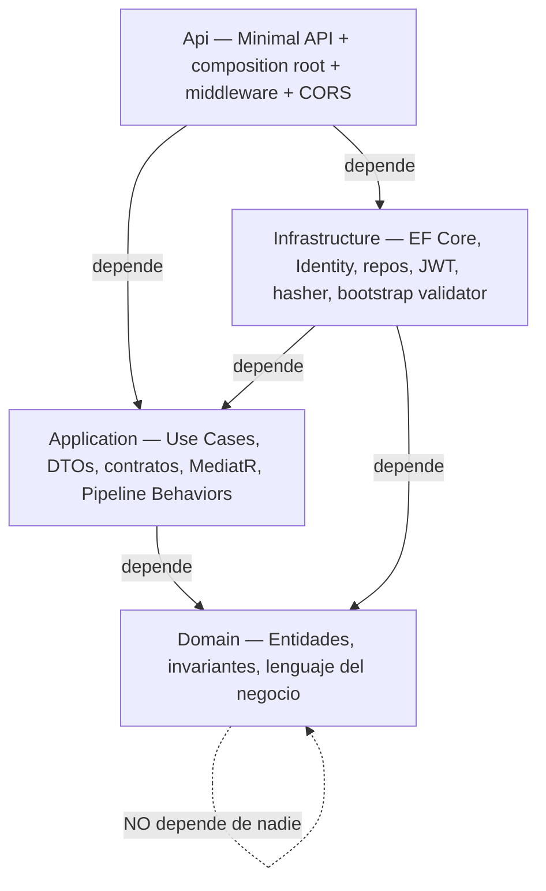

# Roadmap de Implementación — Portfolio Backend (Clean Architecture + CQRS + MediatR + Identity + JWT)

> Documento vivo. Cada fase es una unidad ejecutable **por vos** con scope cerrado, criterios de aceptación explícitos y dependencias claras de la fase anterior. No hay código explícito: este roadmap es una **guía**. Cuando necesites ayuda con "cómo se hace X", me preguntás.

---

## TL;DR

Vas a construir una **Minimal API en .NET 10** con **Clean Architecture en 4 capas + CQRS + MediatR + ASP.NET Identity + JWT Bearer** para un portfolio público con admin incluido. El estado actual del repo es solo `Domain` con dos entidades (`Project`, `User`). Las 16 fases que siguen llevan hasta una API corriendo con:

- Lectura pública (formato flashcard para el grid + formato blog para el detalle).
- Admin autenticado con JWT vía cookie httpOnly.
- CRUD completo de proyectos con soft delete + restore.
- Pipeline behaviors de validación, logging, autorización y auditoría.
- CORS configurado para que el frontend Astro pueda llamarla.
- Tests de integración del flujo completo.

**Lo que NO entra en este roadmap (queda para "fase futura"):**
- Multi-usuario (es tu portfolio de un solo dueño).
- Refresh tokens (access token de larga duración es suficiente).
- Password reset / forgot password.
- Roles múltiples (solo `Admin`).
- Tags, categorías, búsqueda/filtrado en el listado público.
- Endpoint de upload de imágenes al backend. Las URLs (tanto del `UrlThumbnail` como las inline en el `Content` markdown) son **URLs externas** que vos pegás en el admin. El backend no toca storage.
- OAuth / social login.
- Auditoría persistente en DB (se loguea por ahora).
- Multi-workspace.

**Supuestos cerrados** (ver § Decisiones Arquitectónicas): `AppDbContext` único que extiende `IdentityDbContext`, sin refresh tokens, sin password reset, sin multi-rol, sin upload de imágenes, un solo agregado de negocio (`Project`) más la entidad de Identity (`ApplicationUser`).

---

## Índice de Fases

| # | Fase | Depende de | Output verificable |
|---|------|------------|--------------------|
| 0 | Mental model refresh + conceptos nuevos | — | 4 capas en mente + CQRS, MediatR, Identity, JWT, CORS explicados |
| 1 | Ajustar el Domain | F0 | `Project` queda intacto, `ApplicationUser` reemplazando al `User` viejo, sin `IRepository<T>` |
| 2 | Diagrama de clases del dominio | F1 | `docs/diagrams/domain-class-diagram.md` actualizado |
| 3 | Application: abstracciones | F1 | Proyecto `Application/` compila, interfaces de repos y auth definidas |
| 4 | Application: DTOs + `Result<T>` | F3 | DTOs de lectura, escritura y auth listos, `Result<T>` implementado |
| 5 | Application: Use Cases (sin MediatR) | F3, F4 | Handlers como clases inyectables + tests unitarios verdes |
| 6 | Introducir MediatR | F5 | Handlers implementan `IRequestHandler`, controllers usan `ISender`, tests siguen verdes |
| 7 | Pipeline Behaviors | F6 | Validation, Logging, Authorization, Audit behaviors registrados y con tests |
| 8 | Infrastructure: EF Core + Identity | F1 | Migración con tablas de Identity + `projects` + seed del rol `Admin` |
| 9 | Infrastructure: repositorios + servicios auth | F3, F8 | `ProjectRepository`, `UserRepository`, `JwtTokenGenerator`, `PasswordHasher`, `BootstrapTokenValidator` |
| 10 | Infrastructure: composition root | F8, F9 | `AddInfrastructure(...)` registra todo (DbContext + Identity + repos + auth + MediatR + behaviors) |
| 11 | Api: auth endpoints | F4, F5, F10 | `POST /admin/auth/register` (bootstrap) y `POST /admin/auth/login` (cookie httpOnly) funcionando |
| 12 | Api: endpoints públicos | F4, F5, F10 | `GET /projects` y `GET /projects/{slug}` |
| 13 | Api: endpoints admin | F4, F5, F7, F11 | CRUD + restore, todos protegidos con JWT + rol Admin |
| 14 | CORS | F11 | Frontend Astro (dev y prod) puede llamar al backend |
| 15 | Tests de integración | F13, F14 | Auth flow + CRUD admin + lecturas públicas, todo verde |
| 16 | Diagrama final + housekeeping | F2, F15 | `docs/diagrams/architecture.md` + `README.md` actualizados |

Cada fase es ejecutada **por vos**, una a la vez. Si te trabás en algún paso, me preguntás lo específico antes de avanzar.

---

## Decisiones Arquitectónicas Cerradas

| # | Decisión | Elegido | Por qué | Trade-off conocido |
|---|----------|---------|---------|--------------------|
| D1 | Relación `User ↔ Project` | Sin FK | Portfolio anónimo; el admin no es "autor" de proyectos | No hay navegación de User a Projects (no se necesita) |
| D2 | Alcance de auth | Admin completo con Identity + JWT | El producto final requiere CRUD autenticado | Mayor superficie que un read-only |
| D3 | Patrón de Use Case | MediatR con CQRS split | Queries públicas (lectura) + Commands de admin (escritura con auth) justifican la separación | Más boilerplate; requiere entender MediatR |
| D4 | DbContext | Único `AppDbContext` que extiende `IdentityDbContext<ApplicationUser>` | Suficiente; Identity agrega sus tablas sin esfuerzo extra | Si el dominio crece, dividir por agregado es costoso |
| D5 | Persistencia dev | SQLite (archivo local) | Cero setup, coincide con el runbook | Provider distinto al de prod (PostgreSQL) |
| D6 | Persistencia prod | PostgreSQL 15 (Turso/Render) | Decisión previa del proyecto | — |
| D7 | Manejo de errores | `Result<T>` tipado en Application, `ProblemDetails` en Api | Flujo explícito de éxito/fallo sin excepciones de control | Hay que implementar el mapper `Result → IResult` |
| D8 | Validación de input | FluentValidation en Commands (a partir de F7) | Reglas compuestas, reutilizable entre handlers | Sumar paquete `FluentValidation.DependencyInjectionExtensions` |
| D9 | Versionado de código | Conventional Commits + ramas `feature/`, `fix/`, `refactor/`, `chore/`, `docs/` | Estándar | — |
| D10 | Target framework | `net10.0` | Ya estaba en `Domain.csproj` | — |
| D11 | Auth strategy | ASP.NET Core Identity + JWT Bearer | Estándar de mercado, opinionated pero probado | Identity arrastra convenciones; aprender a configurarlo |
| D12 | Provisioning del primer admin | Endpoint `POST /admin/auth/register` con header `X-Bootstrap-Token` validado contra env var `Bootstrap__Token` | Single-owner, self-hosted. El endpoint falla si ya existe un usuario (queda inútil) | Si el token se filtra, solo se puede crear UN usuario extra antes de quedar bloqueado |
| D13 | Roles | Un solo rol: `Admin` | Single-owner portfolio | YAGNI multi-rol |
| D14 | Refresh tokens | No, solo access token con vida larga (8-12 horas) | Suficiente para un admin que edita su propio portfolio | Re-login cada 8-12 horas |
| D15 | Storage del JWT en el cliente | Cookie `httpOnly` + `Secure` + `SameSite=Strict` | Estándar SSR-safe, mitiga XSS | Requiere configurar CORS con `AllowCredentials = true` y origen explícito |
| D16 | MediatR scope | Aplicado a TODOS los use cases (no solo a los nuevos de admin) | Consistencia total en el repo; se aprende una sola vez el patrón | F5 escribe handlers como clases, F6 los refactoriza a `IRequestHandler` |
| D17 | Pipeline Behaviors en V1 | `ValidationBehavior`, `LoggingBehavior`, `AuthorizationBehavior`, `AuditBehavior` | Cross-cutting concerns reales que se repiten en cada Command del admin | Más clases a mantener; se amortiza con el primer Command nuevo |
| D18 | Soft delete | Sí, desde V1. `DELETE` setea `DeletedAt`, hay endpoint `POST .../restore`. Filtro global con `HasQueryFilter`. La lógica de setear/limpiar `DeletedAt` vive en la **entidad** (`Project.MarkAsDeleted` / `Project.Restore`); el repo es delgado y delega (D22) | El admin necesita poder borrar y arrepentirse | El listado público filtra `DeletedAt != null` automáticamente |
| D19 | CORS | Configurado desde F14 | El frontend existe y necesita llamar al backend desde otro origen | Sumar config de orígenes permitidos |
| D20 | Storage de imágenes | URLs externas (no hay endpoint de upload) | El admin pega URLs de Cloudinary/Imgur/lo que sea. El backend no toca storage | Las imágenes inline en el `Content` markdown funcionan vía URL |
| D21 | Idioma del dominio | Inglés (`Project`, `ApplicationUser`, `ProjectState`, etc.) | Convención del proyecto, no se mezcla español-inglés en el código | Los commits y mensajes pueden ser en español si querés |
| D22 | Modelo de `Project` | **Semi-rico** (estándar DDD del mercado): entidad con setters `private`, métodos de comportamiento públicos para reglas de negocio (`MarkAsDeleted`, `Restore`, `SetActive`, `SetInactive`). El repo es **delgado**: delega al dominio y persiste. El handler es **orquestador**: llama al repo, propaga errores, NO manipula la entidad directamente. | Encapsulación total (nadie toca `DeletedAt` desde fuera), reglas de soft-delete testeables sin EF, repo sin lógica de negocio, handler limpio. | Hay que mantener `IProjectRepository.SoftDeleteAsync`/`RestoreAsync` aunque la lógica viva en la entidad — el repo centraliza la operación para que el handler no llame a la entidad y al repo por separado. |
| D23 | Forma de `DeleteProjectCommand` / `RestoreProjectCommand` | Solo `string Slug` (no `Id` ni nada más) | El endpoint admin es `DELETE /admin/projects/{slug}` y `POST /admin/projects/{slug}/restore` (l.1310-1311 del propio roadmap). El `Id` es interno, se obtiene con `GetBySlugAsync` desde el handler. Evita redundancia 1-a-1 entre `Id` y `Slug` | Si alguna vez la UI/admin conoce el `Id` y quiere evitar el lookup, se cambia la firma. Es un único punto de contacto |
| D24 | Propagación de `Failure` desde el repo en Command handlers | **Sí**, los handlers verifican `!result.IsSuccess` y **propagan el `Error` del repo tal cual** (`return result;`) antes de llamar a `SaveChangesAsync` | Permite que el repo reporte fallos reales (ej: restricción única de `Slug` en EF, conflicto de concurrencia) sin que el handler devuelva un `Success` mentiroso. **No** se inventan códigos de error nuevos en el handler: si el repo sabe por qué falló, su `Error` ya tiene el código correcto. Coherente con D7 (`Result<T>` explícito, sin excepciones de control) | Más líneas en cada handler. El precio vale la pena: nunca un `Success` falso y nunca se pierde información del repo |

---

## Arquitectura: las 4 capas



**Regla de dependencia (la única regla de oro):** las flechas apuntan al centro. `Domain` no conoce a nadie. `Application` solo conoce `Domain`. `Infrastructure` y `Api` conocen todo y son las únicas capas que tocan el mundo exterior (DB, HTTP, secrets, clock, JWT, etc.).

### Qué vive en cada capa

| Capa | Contiene | NO contiene |
|------|----------|-------------|
| `Domain` | Entidades (`Project`, `ApplicationUser`), invariantes, enums, value objects | Interfaces de repos, EF Core, Identity (su paquete de tipos vive acá como dependencia, pero su configuración NO), HTTP, DTOs, JWT, MediatR |
| `Application` | Use Cases (`Commands`, `Queries`), DTOs, `Result<T>`, contratos (`IProjectRepository`, `IUserRepository`, `IJwtTokenGenerator`, `IPasswordHasher`, `IBootstrapTokenValidator`, `ICurrentUser`, `IUnitOfWork`), MediatR handlers, Pipeline Behaviors, validadores FluentValidation | EF Core, `DbContext`, `UserManager`, JwtBearer middleware, secrets, implementaciones concretas, HttpContext |
| `Infrastructure` | `AppDbContext` (extiende `IdentityDbContext`), configuraciones EF, migraciones, seed, `ProjectRepository`, `UserRepository`, `UnitOfWork`, `JwtTokenGenerator`, `PasswordHasher`, `BootstrapTokenValidator`, `CurrentUser` (lee del HttpContext via IHttpContextAccessor) | Use cases, DTOs, lógica de negocio, controllers |
| `Api` | `Program.cs` (composition root), endpoints minimal, middleware, configuración de JWT Bearer, configuración de cookies, OpenAPI/Swagger, Problem Details, CORS | Entidades de dominio directamente, lógica de negocio propia |

### Dónde encajan los conceptos nuevos

| Concepto | Capa | Por qué |
|---|---|---|
| `ApplicationUser : IdentityUser<Guid>` | Domain | Es la entidad de usuario. Identity provee la clase base, pero la entidad es nuestra. |
| `IdentityDbContext<ApplicationUser>` | Infrastructure | EF Core + Identity. Detalle de persistencia. |
| `UserManager<ApplicationUser>` | Infrastructure (solo dentro de `UserRepository`) | Identity. Application NO lo conoce directamente; lo envuelve vía `IUserRepository`. |
| MediatR (`ISender`, `IRequest`, `IRequestHandler`) | Application | Los handlers son casos de uso. |
| Pipeline Behaviors | Application | Envuelven a los handlers. Validación, logging, autorización, auditoría. |
| Generación de JWT (`JwtSecurityTokenHandler`, claims, firma) | Infrastructure (`JwtTokenGenerator`) | Es mecanismo técnico, no de negocio. |
| Validación del JWT en cada request | Api (middleware `UseAuthentication` + `UseAuthorization`) | Es política HTTP. |
| Cookie httpOnly | Api (configuración de `CookieAuthenticationOptions` o helpers custom) | Política HTTP. |
| CORS | Api (`builder.Services.AddCors` + `app.UseCors`) | Política HTTP. |
| `Bootstrap__Token` (env var) | Api lee, Infrastructure valida | Es un secret de configuración que Api pasa al validator. |

---

## Nuevos conceptos (explicados brevemente, se profundiza en cada fase)

### ASP.NET Core Identity + JWT Bearer

**Identity** es el framework de Microsoft para identidad: provee `UserManager<TUser>` (crear usuarios, hashear contraseñas), `SignInManager<TUser>` (login), `RoleManager<TRole>` (roles), tablas predefinidas en la DB, hashing seguro de contraseñas, lockout, etc.

**JWT Bearer** es un esquema de autenticación stateless: tras un login exitoso, el servidor firma un **token** (un string largo) que codifica quién es el usuario. El cliente lo envía en cada request (en nuestro caso, dentro de una cookie httpOnly) y el servidor lo valida sin tener que consultar la DB.

**Cómo encajan**: Identity maneja "quién sos y qué podés hacer". JWT Bearer transporta esa identidad entre requests sin guardar sesión en el servidor.

### CQRS (Command Query Responsibility Segregation)

**Idea central**: separar las operaciones que **escriben** (Commands) de las que **leen** (Queries). Cada una tiene su handler, su DTO de input, su lógica. En nuestro proyecto:
- `GetProjectsQuery` (Query, no muta estado, devuelve DTOs de lectura).
- `CreateProjectCommand` (Command, muta estado, devuelve success/failure).
- `UpdateProjectCommand`, `DeleteProjectCommand`, `RestoreProjectCommand`, `RegisterCommand`, `LoginQuery`.

El "split" se materializa en carpetas separadas (`Commands/` vs `Queries/`) y en el modelado de los DTOs (los de Query suelen ser "ligeros", los de Command suelen ser input de formularios).

### MediatR

**Librería** (NuGet) que implementa el patrón Mediator. En vez de inyectar N handlers en el controller (`ctor(GetProjectsHandler, GetProjectBySlugHandler, CreateProjectHandler, ...)`), inyectás un único `ISender` y mandás mensajes. MediatR encuentra el handler correcto en runtime.

**Convención**:
- Cada Command es un `record` que implementa `IRequest<TResponse>` (o `IRequest<Result<TResponse>>` en nuestro caso).
- Cada Query es un `record` que implementa `IRequest<TResponse>`.
- Cada Handler es una clase que implementa `IRequestHandler<TRequest, TResponse>` con un método `Handle` (sin Async — MediatR detecta `async` por el `Task<TResponse>`).
- El controller hace `_sender.Send(new GetProjectsQuery(...))`.

### Pipeline Behaviors

**Middlewares de MediatR**. Cada request que pasa por `ISender.Send()` atraviesa una pila de behaviors antes de llegar al handler y de regreso. Cada behavior cumple UNA responsabilidad cross-cutting.

**Ejemplo del flujo con nuestros 4 behaviors**:
```
Controller → ISender.Send(new CreateProjectCommand(...))
  → LoggingBehavior           (arranca timer)
    → AuthorizationBehavior   (¿hay usuario autenticado? ¿es Admin?)
      → ValidationBehavior    (¿el input es válido? sino, 400)
        → AuditBehavior       (registra intento)
          → Handler            (lógica de negocio)
        ← AuditBehavior       (registra resultado)
      ← ValidationBehavior
    ← AuthorizationBehavior
  ← LoggingBehavior           (log duración + resultado)
←
```

**Nota sobre la implementación**: el registro real en `Application/DependencyInjection.cs` es `Audit → Logging → Authorization → Validation → Handler`, es decir Audit queda **más afuera** que en el diagrama. La razón es que el `AuditBehavior` registra el intento y su veredicto: si fuera el más interno, la auditoría solo anotaría comandos que ya pasaron autorización y validación, y la rama de "failure" del behavior no se dispararía casi nunca. Con Audit afuera también quedan registrados los intentos rechazados.

El resto del orden sí coincide con el diagrama: la autorización va antes que la validación (un cliente anónimo recibe 401 en vez de 400, así no puede descubrir el esquema de un endpoint admin) y el logging envuelve a las dos puertas, así que toda petición deja rastro. `tests/Application.Tests/Behaviors/PipelineOrderTests.cs` fija el orden, para que un cambio de registro rompa la suite en vez de apartarse de la documentación en silencio.

Si el handler tira una excepción, los behaviors la pueden capturar y traducir (e.g., `ValidationBehavior` traduce a `Result.Failure`).

### Bootstrap Token Pattern

Patrón de **primer usuario** para apps self-hosted. El endpoint de registro requiere un token especial (configurado por env var). Si ya existe algún usuario, falla con `409 Conflict`. Garantiza que solo se cree un admin inicial; el endpoint queda **inútil** después.

**Por qué es seguro para vos**: aunque el token se filtre, el atacante solo puede crear UN usuario antes de que el endpoint quede bloqueado. Y vos sos el único que va a usar el admin. Es mejor que un register público (donde cualquiera podría crear cuentas) y más simple que sembrar credenciales hardcodeadas.

### CORS (Cross-Origin Resource Sharing)

Restricción de seguridad del navegador. Cuando tu frontend está en `https://miportfolio.com` y tu backend en `https://api.miportfolio.com`, son **orígenes distintos** (esquema + dominio + puerto). El navegador, por defecto, **bloquea** las llamadas JS de uno al otro a menos que el backend incluya el header `Access-Control-Allow-Origin` con el origen permitido.

En dev: frontend Astro en `http://localhost:4321`, backend en `https://localhost:5001` → orígenes distintos → CORS necesario.

En prod: dominios reales, lo mismo.

Sin CORS configurado, **el frontend no puede llamar al backend aunque todo lo demás funcione**.

---

## Convenciones Globales (aplican a TODAS las fases)

### Naming C#

- PascalCase para clases, métodos, propiedades públicas.
- Una clase por archivo, nombre del archivo = nombre de la clase.
- `I` + PascalCase para interfaces.
- `_camelCase` para campos privados.
- En inglés. Aunque los commits y los comentarios puedan ser en español, los identificadores del código van en inglés.

### Async/Await

- Todo método que hace I/O devuelve `Task` o `Task<T>`.
- Sufijo `Async` en el nombre del método (excepto los handlers de MediatR, que se llaman `Handle` por convención de la librería).
- Sin `.Result` ni `.Wait()`.
- `CancellationToken ct = default` como último parámetro en métodos async públicos.

### Errores

- Application: `Result<T>` para éxito/fallo, `Error` con `Code` y `Message`.
- Api: `ProblemDetails` (RFC 7807) en responses de error.
- Nunca propagar excepciones de control (e.g., throw `NotFoundException`). Devolver `Result.Failure`.

### Inyección de dependencias

| Servicio | Lifetime | Justificación |
|----------|----------|---------------|
| `AppDbContext` | Scoped | Una instancia por request, maneja la unidad de trabajo |
| `UserManager<ApplicationUser>`, `RoleManager<IdentityRole>` | Scoped | Identity los inyecta así por defecto |
| Repositorios | Scoped | Comparten el `DbContext` dentro del request |
| `IJwtTokenGenerator`, `IPasswordHasher`, `IBootstrapTokenValidator` | Singleton | Stateless |
| `ICurrentUser` | Scoped | Lee del `HttpContext` actual, depende del request |
| Use cases (handlers de MediatR) | Transient (default de MediatR) | Stateless |
| Pipeline Behaviors | Transient (default de MediatR) | Stateless |

### Estructura de carpetas para Application

```
Application/
├── Abstractions/
│   ├── Persistence/         (IProjectRepository, IUserRepository, IUnitOfWork)
│   ├── Authentication/      (IJwtTokenGenerator, IPasswordHasher, IBootstrapTokenValidator)
│   └── Common/              (ICurrentUser, Result, Error)
├── Behaviors/               (Validation, Logging, Authorization, Audit)
├── Projects/
│   ├── Commands/
│   │   ├── CreateProject/
│   │   │   ├── CreateProjectCommand.cs          (record : IRequest<Result<Guid>>)
│   │   │   ├── CreateProjectCommandHandler.cs  (IRequestHandler<...>)
│   │   │   └── CreateProjectValidator.cs       (FluentValidation, en F7)
│   │   ├── UpdateProject/
│   │   ├── DeleteProject/
│   │   └── RestoreProject/
│   ├── Queries/
│   │   ├── GetProjects/
│   │   └── GetProjectBySlug/
│   └── Dtos/                (ProjectSummaryDto, ProjectDetailDto, ProjectListDto, requests)
├── Authentication/
│   ├── Commands/
│   │   └── Register/
│   ├── Queries/
│   │   └── Login/
│   └── Dtos/                (RegisterRequest, LoginRequest, AuthResponse)
```

### Tests

- Framework: **xUnit**.
- Assertions: **FluentAssertions**.
- Mocks/fakes para repositorios: **NSubstitute** o **fakes hechos a mano**. Para `IUserRepository` conviene fake (más claro). Para `IJwtTokenGenerator` o `ICurrentUser` un stub basta.
- Naming: `MethodName_WhenCondition_ThenExpectedResult`.
- Cobertura mínima por handler: caso feliz, caso "no encontrado" / "input inválido", caso "conflicto" si aplica.

### Commits

Conventional Commits. Ejemplos para este roadmap:

```
refactor(domain): replace User with ApplicationUser extending IdentityUser
feat(application): add project and auth abstractions
feat(application): add command and query DTOs and Result type
feat(application): add project commands and queries as plain handlers
feat(application): introduce MediatR and refactor handlers to IRequestHandler
feat(application): add validation, logging, authorization, audit behaviors
feat(infrastructure): add AppDbContext extending IdentityDbContext
feat(infrastructure): add ProjectRepository, UserRepository, auth services
feat(infrastructure): add composition root with all registrations
feat(api): add auth endpoints with bootstrap token and httpOnly cookie
feat(api): add public project endpoints
feat(api): add admin project endpoints (CRUD + restore)
feat(api): configure CORS for dev and prod
test(api): add integration tests for auth flow and admin CRUD
docs(architecture): update final architecture diagram and README
```

### Qué NO hacer en NINGUNA fase

- Devolver entidades de `Domain` desde los endpoints (siempre vía DTO).
- Usar `DbContext` o `UserManager` fuera de `Infrastructure`.
- Inyectar `IServiceCollection` o `IConfiguration` en clases de `Application` o `Domain`.
- Crear dependencias circulares entre proyectos.
- Mezclar español con inglés en identificadores de código.
- Hardcodear secrets (JWT signing key, bootstrap token) en código o `appsettings.json` commiteado.

---

## Contrato del agente (vos)

Cada fase la ejecutás vos, una a la vez. Este contrato es ley para las 16 fases.

### Qué podés hacer

- Crear, modificar o eliminar archivos **explícitamente listados** en la sección "Archivos a tocar" de cada fase.
- Agregar paquetes NuGet listados en la sección "Paquetes" (cuando aplique).
- Crear tests en los proyectos de test listados en la fase.

### Qué NO podés hacer

- Tocar archivos de fases anteriores que no estén en tu scope actual (crea diff huérfanos).
- Cambiar decisiones cerradas (D1–D21). Si encontrás conflicto, **detenerse y preguntarme**.
- Saltarte el checkpoint. Si no compila o los tests no pasan, la fase no se cierra.
- Pedirme que escriba el código de la fase. El roadmap es la guía. Cuando te trabes en "cómo se hace X", me preguntás, te explico, y vos lo implementás.

### Output esperado al cerrar cada fase

1. Lista de archivos creados / modificados / eliminados (vos lo llevás en tu cabeza o en un doc, no hace falta que me lo reportes a menos que te pida).
2. `dotnet build` y `dotnet test` verdes.
3. Un commit (vos decidís cuándo, según tu flujo).

### Cómo pedirme ayuda

- "Estoy en F5. ¿Cómo escribo un handler que devuelve `Result<T>`?"
- "Estoy en F6. ¿Cómo registro MediatR en el composition root?"
- "Estoy en F7. ¿Cómo se implementa un `IPipelineBehavior`?"
- "Estoy en F11. ¿Cómo seteo una cookie httpOnly desde Minimal API?"

Tantas preguntas como necesites. Cuanto más específica la pregunta, mejor la respuesta.

---

## FASE 0 — Mental model refresh + conceptos nuevos

**Objetivo:** internalizar las 4 capas, dónde encajan MediatR, Identity, JWT, CORS y el bootstrap pattern. No se toca código.

**Duración estimada:** 1–2 horas (lectura + investigación + dibujo a mano).

**Depende de:** nada.

**Conceptos teóricos a investigar/entender (en este orden):**
1. Las 4 capas y la regla de dependencia (ya las conocés, refrescar).
2. **CQRS**: qué problema resuelve, qué diferencia hay entre Command y Query, cuándo se justifica separarlos.
3. **MediatR**: qué es `ISender`, qué es `IRequest`, qué es `IRequestHandler`. Leer el README oficial.
4. **Pipeline Behaviors**: qué son, qué problema resuelven, ejemplos típicos (validation, logging).
5. **ASP.NET Identity**: qué provee, qué limitaciones tiene para APIs stateless, cómo se combina con JWT.
6. **JWT Bearer**: qué es un JWT, qué contiene (claims), cómo se firma y se valida, qué significa "stateless".
7. **CORS**: por qué existe la restricción, qué pasa si no se configura, cómo se configura del lado del backend.
8. **Bootstrap token pattern**: por qué se usa en apps self-hosted, qué garantiza.

**Tareas concretas:**
1. Releer este roadmap completo (secciones TL;DR, Arquitectura, Conceptos nuevos).
2. Para cada concepto nuevo, leer un recurso corto (artículo oficial, blog post, video de 5-10 min). Anotar en una hoja: "qué es", "qué problema resuelve", "dónde vive en mi proyecto".
3. Dibujar a mano las 4 capas con las flechas de dependencia. Agregar anotaciones: dónde vive MediatR, dónde vive Identity, dónde vive JWT, dónde vive CORS, dónde se ejecuta cada pipeline behavior.
4. Pintar mentalmente cada archivo nuevo del proyecto del color de su capa.

**Checkpoint:**
- [x] Podés dibujar de memoria las 4 capas con MediatR, Identity, JWT, CORS anotados.
- [x] Podés explicar en una frase cada uno de los 6 conceptos nuevos.
- [x] Podés responder: ¿dónde vive el `DbContext`? ¿dónde vive el `UserManager`? ¿dónde vive el `ISender`? ¿dónde se configura CORS?
- [x] Podés explicar por qué el bootstrap token pattern es seguro para tu caso.

**Output esperado:** ninguno (es solo lectura + dibujo mental + investigación).

---

## FASE 1 — Ajustar el Domain

**Objetivo:** dejar `Domain` listo para Identity. Borrar la abstracción genérica. Reemplazar `User` por `ApplicationUser` que extiende `IdentityUser<Guid>`.

**Duración estimada:** 2–3 horas.

**Depende de:** F0.

**Concepto teórico:**
- **`IdentityUser<TKey>`**: clase base de Microsoft para usuarios. Ya tiene `Id`, `UserName`, `Email`, `PasswordHash`, `SecurityStamp`, etc. Nuestra clase de usuario debe extenderla para integrarse con Identity.
- **Migración de validaciones**: la entidad `User` vieja tiene regex de email, length limit, validación de password hash. Esas invariantes se mueven al Command handler con FluentValidation (en F7). La entidad queda más limpia y la validación es testeable sin instanciar la entidad.
- **Modelo semi-rico de `Project` (D22)**: la entidad tiene setters `private` y expone métodos de comportamiento para las reglas de negocio: `SetActive`/`SetInactive` (cambian `ProjectState` + `UpdatedAt`) y `MarkAsDeleted`/`Restore` (manejan `DeletedAt` + `UpdatedAt`, idempotentes). El repo es delgado: delega a esos métodos y persiste. El handler NO manipula la entidad directamente, llama al repo.

**Estado inicial:**
- `Domain/Entities/Project.cs` con setters `private`, validaciones en constructor, métodos de comportamiento `SetActive`/`SetInactive` (cambian `ProjectState` + `UpdatedAt`, NO tocan `DeletedAt`) y los métodos de soft-delete/restore que se detallan abajo.
- `Domain/Entities/User.cs` con validación de email/password hash en constructor.
- `Domain/Abstractions/IRepository.cs` con CRUD genérico.
- `Domain/Domain.csproj` apuntando a `net10.0`.

**Archivos a tocar:**

| Acción | Path | Razón |
|--------|------|-------|
| Eliminar | `Domain/Abstractions/IRepository.cs` | La abstracción genérica se reemplaza por interfaces específicas en Application |
| Eliminar | `Domain/Entities/User.cs` | Se reemplaza por `ApplicationUser` que extiende `IdentityUser<Guid>` |
| Crear | `Domain/Entities/ApplicationUser.cs` | Nueva entidad que extiende `IdentityUser<Guid>` |
| Modificar | `Domain/Domain.csproj` | Agregar referencia al paquete `Microsoft.Extensions.Identity.Stores` (que contiene `IdentityUser<TKey>`). NO agregar EF Core ni nada más externo. |

**Decisiones a tomar:**
- **D1.3 — Validación de email en `ApplicationUser`.** Las invariantes que tenía `User` se mantienen en el constructor de `ApplicationUser` o se delegan al Command handler con FluentValidation. **Recomendado: FluentValidation** (en F7). La entidad queda sin lógica de validación, los Commands usan validadores.
- **D1.4 — ¿Agregar campos custom a `ApplicationUser`?** Por ejemplo, `DisplayName` para mostrar en el admin. **Recomendado: NO en V1**. Solo lo que Identity ya provee (`Email`, `PasswordHash`, etc.). Si después necesitás algo custom, agregás un campo con su migration.

**Tareas concretas:**
1. Borrar `Domain/Abstractions/IRepository.cs` y `Domain/Entities/User.cs`.
2. Crear `ApplicationUser` que extienda `IdentityUser<Guid>`. Clase vacía — sin constructor custom ni lógica de validación (las invariantes van a FluentValidation en F7).
3. Agregar el paquete `Microsoft.Extensions.Identity.Stores` a `Domain.csproj`. Verificar que NO se agreguen paquetes de EF Core ni de Identity EF (esos van en Infrastructure).
4. Verificar que `dotnet build` siga verde.

**Errores comunes:**
- ❌ Agregar EF Core a `Domain.csproj` (debe quedar sin dependencias de persistencia).
- ❌ Agregar `Microsoft.AspNetCore.Identity.EntityFrameworkCore` a `Domain.csproj` (ese paquete trae EF Core como dependencia transitiva).
- ❌ No borrar `IRepository.cs` "por las dudas". Se reemplaza en F3. Dejarlo genera confusión.
- ❌ Cambiar el nombre de `ProjectState` a `EstadoProyecto`. El dominio va en inglés (D21).

**Scope:**
- ✅ Modificar `Domain/` (solo agregar `ApplicationUser` y borrar `User.cs` + `IRepository.cs`), agregar paquete `Microsoft.Extensions.Identity.Stores`.
- ❌ NO crear `Application/`, `Infrastructure/`, `Api/` (todavía no existen).
- ❌ NO configurar Identity ni agregar `IdentityDbContext` (eso es F8).

**Checkpoint:**
- [x] `dotnet build` verde.
- [x] `Project.cs` queda con setters `private` y métodos de comportamiento `SetActive`/`SetInactive`/`MarkAsDeleted`/`Restore` (D22, modelo semi-rico). `SetActive`/`SetInactive` NO tocan `DeletedAt`.
- [x] `ApplicationUser.cs` compila y extiende `IdentityUser<Guid>`.
- [x] `Domain/Abstractions/` está vacío o eliminado.
- [x] No hay rastros del viejo `User.cs`.

**Cuando te trabes, preguntame sobre:**
- Cómo se usa exactamente `IdentityUser<Guid>` y qué campos custom vale la pena agregar.
- Si las URLs deberían ser Value Objects en vez de strings simples.
- Cómo manejar el `Id` de `Project` (Guid generado en el cliente o en el server).
- Qué paquete NuGet exactamente trae `IdentityUser<TKey>` sin arrastrar EF Core.

---

## FASE 2 — Diagrama de clases del dominio

**Objetivo:** documentar visualmente el dominio estabilizado en F1, incluyendo `ApplicationUser`.

**Duración estimada:** 30–60 minutos.

**Depende de:** F1.

**Concepto teórico:** (igual que en el roadmap anterior). El class diagram muestra **comportamiento**, no solo datos. No incluir getters/setters triviales. No incluir relaciones entre `Project` y `User` (D1: sin FK).

**Estado inicial:** `Domain` quedó como resultado de F1 (`Project` intacto + `ApplicationUser`).

**Archivos a tocar:**

| Acción | Path | Razón |
|--------|------|-------|
| Crear | `docs/diagrams/domain-class-diagram.md` | Documentar visualmente el dominio estabilizado |

**Contenido esperado del archivo:**
- Frontmatter con fecha.
- Sección "Cómo leer este diagrama".
- Bloque Mermaid `classDiagram` que muestre:
  - `Project` con `Id`, `Title`, `Slug`, `UrlThumbnail`, `Description`, `Content`, `State` (enum), `CreatedAt`, `UpdatedAt`, `DeletedAt`.
  - Métodos públicos de `Project`: `SetActive()`, `SetInactive()`.
  - `ApplicationUser` extendiendo `IdentityUser<Guid>`. Solo los campos custom si decidiste agregar alguno en D1.4. Los campos heredados de `IdentityUser` (Email, PasswordHash, etc.) NO se listan (son de la librería).
- No mostrar relaciones entre `Project` y `User`.

**Decisiones a tomar:**
- **D2.1 — Visibilidad.** Mostrar todos los campos como públicos (en C# son propiedades, pero en el diagrama se ven como `+Title: string`).
- **D2.2 — Métodos privados.** No se muestran.

**Errores comunes:**
- ❌ Listar todos los campos heredados de `IdentityUser` en `ApplicationUser` (rompe la abstracción).
- ❌ Agregar navegación a `User` desde `Project` para "prever el futuro". Hoy no existe.
- ❌ Mezclar con el ER de `docs/diagrams/DER - Portfolio.md`. Son documentos distintos.

**Scope:**
- ✅ Crear `docs/diagrams/domain-class-diagram.md`.
- ❌ NO tocar código de `Domain/`.

**Checkpoint:**
- [x] El archivo existe y renderiza correctamente.
- [x] Refleja fielmente el código actual (no el deseado).
- [x] No muestra métodos privados ni getters/setters.

**Cuando te trabes, preguntame sobre:**
- Sintaxis Mermaid para heredar de una clase externa (`IdentityUser<Guid>`).
- Cómo representar el enum `ProjectState`.

---

## FASE 3 — Application: abstracciones

**Objetivo:** crear el proyecto `Application` con todas las interfaces que necesita, sin saber cómo se implementan.

**Duración estimada:** 1–2 horas.

**Depende de:** F1.

**Concepto teórico:**
- **Las interfaces de repo NO viven en `Domain`**. Es un error clásico. Si vivieran en `Domain`, este arrastraría convenciones del ORM. Las interfaces reflejan **lo que la capa que las usa necesita**; por eso viven en `Application/Abstractions/`.
- **`IUserRepository` envuelve Identity**. Application no debe usar `UserManager<ApplicationUser>` directamente (Identity vive en Infrastructure). `IUserRepository` expone los métodos que Application necesita (buscar por email, crear, validar password), y la implementación concreta en F9 usa `UserManager` por detrás.
- **`ICurrentUser` para auditoría**. Los pipeline behaviors necesitan saber "quién está haciendo este Command". `ICurrentUser` expone `Id` y `IsAdmin` desde el `HttpContext`. La implementación concreta vive en Infrastructure y usa `IHttpContextAccessor`.
- **`IBootstrapTokenValidator`**. Encapsula la validación del token de bootstrap. Application no sabe cómo se valida (si con config, si con un HashSet en memoria, etc.).

**Estado inicial:**
- `Domain` con `Project` y `ApplicationUser`.
- `Application/` no existe.
- Solución solo contiene `Domain`.

**Archivos a tocar:**

| Acción | Path | Razón |
|--------|------|-------|
| Crear | `Application/Application.csproj` | Nuevo proyecto, referencia a `Domain` |
| Crear | `Application/Abstractions/Persistence/IProjectRepository.cs` | Interfaz específica del agregado Project |
| Crear | `Application/Abstractions/Persistence/IUserRepository.cs` | Wrapper sobre Identity |
| Crear | `Application/Abstractions/Persistence/IUnitOfWork.cs` | Para confirmar cambios |
| Crear | `Application/Abstractions/Authentication/IJwtTokenGenerator.cs` | Contrato para generar JWTs |
| Crear | `Application/Abstractions/Authentication/IPasswordHasher.cs` | Contrato para hashear/verificar passwords |
| Crear | `Application/Abstractions/Authentication/IBootstrapTokenValidator.cs` | Contrato para validar el token de bootstrap |
| Crear | `Application/Abstractions/Common/ICurrentUser.cs` | Contrato para acceder al usuario actual |
| Modificar | `ajn-portfolio-backend.slnx` | Agregar el nuevo proyecto a la solución |
| Modificar | `Domain/Domain.csproj` | Sin cambios de paquetes; solo se referencia desde `Application` |

**Contratos que vas a definir (descripción):**

- **`IProjectRepository`**: métodos async para `GetByIdAsync(Guid)` que devuelve `Project?`, `GetBySlugAsync(string)` que devuelve `Project?`, `ListAsync` (con filtros internos: solo no soft-deleted) que devuelve lista de solo lectura, `ListIncludingDeletedAsync` (para el admin), `AddAsync(Project)` que devuelve `Task<Result>`, `UpdateAsync(Project)`, **`SoftDeleteAsync(Project, ct)`** que delega a `Project.MarkAsDeleted()` y devuelve `Task<Result>`, **`RestoreAsync(Project, ct)`** que delega a `Project.Restore()` y devuelve `Task<Result>`, **`HardDeleteAsync(Project, ct)`** que hace `Remove` real y devuelve `Task<Result>`. La entidad `Project` es la dueña de las reglas de soft-delete/restore (D22, modelo semi-rico); el repo es delgado.
- **`IUserRepository`**: métodos async para `GetByEmailAsync(string)` que devuelve `ApplicationUser?`, `ExistsByEmailAsync(string)` que devuelve `bool`, `AddAsync(ApplicationUser, string password)` que devuelve `Result` (puede fallar si el email ya existe), `CheckPasswordAsync(ApplicationUser, string password)` que devuelve `bool`. **No** expone `UserManager` directamente.
- **`IUnitOfWork`**: método `SaveChangesAsync` que devuelve el número de cambios.
- **`IJwtTokenGenerator`**: método `GenerateToken(ApplicationUser)` que devuelve un string (el JWT firmado) más la fecha de expiración. Opcionalmente acepta claims extra.
- **`IPasswordHasher`**: método `HashPassword(string plain)` que devuelve el hash. (Identity ya hashea en `UserManager.CreateAsync`, así que este wrapper puede ser opcional o usarse para tests. Decidí vos si lo necesitás o si lo absorbés vía `IUserRepository.AddAsync`.)
- **`IBootstrapTokenValidator`**: método `IsValid(string token)` que devuelve `bool`. Compara en tiempo constante contra el valor configurado.
- **`ICurrentUser`**: propiedades `Id` (Guid?) y `IsAuthenticated` (bool) e `IsAdmin` (bool). Inmutable, snapshot del contexto actual.

**Decisiones a tomar:**
- **D3.1 — `IUnitOfWork` sí o no.** Identity y EF Core ya proveen unidad de trabajo vía `DbContext`/`UserManager`. **Recomendado: SÍ** igual que en el roadmap anterior. Hace que Application sea testeable sin EF.
- **D3.2 — ¿Exponer `IQueryable<T>` en los repos?** **NO**. Los filtros los hace el repo (e.g., `ListAsync` filtra `DeletedAt != null` por defecto). El caller pide cosas, no filtra tablas.
- **D3.3 — ¿`IPasswordHasher` propio o usar el de Identity?** Si `IUserRepository.AddAsync` recibe el password plano y lo pasa a `UserManager.CreateAsync`, no necesitás un `IPasswordHasher` separado. **Recomendado: NO crear `IPasswordHasher`** en esta fase. El password lo maneja Identity por dentro. Borrá esa interfaz de la lista de archivos a tocar.

**Errores comunes:**
- ❌ Poner las interfaces en `Domain/Abstractions/` "porque suena más pro". **NO.**
- ❌ Agregar `IQueryable` a `IProjectRepository`.
- ❌ Hacer que `IUserRepository` devuelva `IEnumerable<T>` cuando podría devolver `IReadOnlyList<T>`.
- ❌ Olvidar el `CancellationToken ct = default` en métodos async públicos.
- ❌ Crear `IPasswordHasher` propio y luego no usarlo.
- ❌ Nombrar `RemoveAsync` al soft-delete (es engañoso). Usá `SoftDeleteAsync` / `RestoreAsync` / `HardDeleteAsync` con nombres honestos (D22).

**Scope:**
- ✅ Crear `Application/`, modificar la `.slnx`, agregar referencia a `Domain` en `Application.csproj`.
- ❌ NO tocar `Domain/`, crear `Infrastructure/`, `Api/`.
- ❌ NO instalar EF Core, Identity EF, MediatR todavía.
- ❌ NO implementar las interfaces (eso es F9).

**Checkpoint:**
- [x] `dotnet build` verde.
- [x] `Application.csproj` tiene referencia a `Domain`.
- [x] La solución incluye ambos proyectos.
- [x] Las interfaces usan `CancellationToken = default` en métodos async.
- [x] `ICurrentUser` es inmutable y se construye una sola vez por request.

**Cuando te trabes, preguntame sobre:**
- Cómo definir un record inmutable para `ICurrentUser`.
- Cómo estructurar las carpetas de `Application/Abstractions/`.
- Si conviene que `IProjectRepository.ListAsync` reciba un parámetro `includeDeleted` o haya dos métodos separados (vos decidís, ambas son válidas).

---

## FASE 4 — Application: DTOs + `Result<T>`

**Objetivo:** tener todos los DTOs (de lectura, de escritura, de auth) listos y el tipo `Result<T>` con `Error`.

**Duración estimada:** 1 hora.

**Depende de:** F3.

**Concepto teórico:** (igual que antes). Entity ≠ DTO. Los DTOs son `record` inmutables. Listado ≠ Detalle. Los DTOs de input (Commands) son distintos de los de output.

**Archivos a tocar:**

| Acción | Path                                                 | Razón                                                                                                                |
| ------ | ---------------------------------------------------- | -------------------------------------------------------------------------------------------------------------------- |
| Crear  | `Application/Projects/Dtos/ProjectSummaryDto.cs`     | DTO para el grid (forma flashcard): Id, Slug, Title, UrlThumbnail, Description                                       |
| Crear  | `Application/Projects/Dtos/ProjectDetailDto.cs`      | DTO para el detalle (forma blog): todos los campos del Summary + Content + State (como string), CreatedAt, UpdatedAt |
| Crear  | `Application/Projects/Dtos/ProjectListDto.cs`        | DTO envolvente con paginación: Items (lista de Summary), Total, Page, PageSize                                       |
| Crear  | `Application/Projects/Dtos/CreateProjectRequest.cs`  | Input para `CreateProjectCommand`: Title, Slug, UrlThumbnail, Description, Content                                   |
| Crear  | `Application/Projects/Dtos/UpdateProjectRequest.cs`  | Input para `UpdateProjectCommand`: mismos campos del Create + Id (para saber cuál actualizar)                        |
| Crear  | `Application/Authentication/Dtos/RegisterRequest.cs` | Input para `RegisterCommand`: Email, Password                                                                        |
| Crear  | `Application/Authentication/Dtos/LoginRequest.cs`    | Input para `LoginQuery`: Email, Password                                                                             |
| Crear  | `Application/Authentication/Dtos/AuthResponse.cs`    | Output de register/login: Token, ExpiresAt (DateTime)                                                                |
| Crear  | `Application/Abstractions/Common/Result.cs`          | Tipo `Result<T>` con métodos estáticos `Success(T)` y `Failure(Error)`                                               |
| Crear  | `Application/Abstractions/Common/Error.cs`           | Tipo `Error` con `Code` (string) y `Message` (string)                                                                |

**Sobre los DTOs de input y validación:** los requests (`CreateProjectRequest`, `LoginRequest`, etc.) NO llevan atributos de validación todavía. La validación rica se hace con FluentValidation en F7. Por ahora los DTOs son solo "forma" (data). Si querés, podés poner `[Required]` con DataAnnotations como defensa básica, pero no es obligatorio.

**Decisiones a tomar:**
- **D4.1 — `State` como string en el DTO.** Acepto que sea `string` (nombre del enum) en lugar de `int`. Más portable entre versiones, más legible en JSON.
- **D4.2 — `AuthResponse` solo contiene Token y ExpiresAt.** No devolver `User` entero ni claims. El frontend ya tiene el token; si necesita más info, hace otra query.
- **D4.3 — `Result<T>` con `T?` y `Error?`.** El `Value` puede ser null (caso de falla), el `Error` puede ser null (caso de éxito). Exponer `IsSuccess` y `IsFailure` como helpers. Métodos estáticos `Success(T)` y `Failure(Error)` para construir.

**Errores comunes:**
- ❌ Devolver la entidad `Project` "porque ya tiene todo". El día que agregues un campo privado, se filtra a la API.
- ❌ Usar `class` en vez de `record`. Los DTOs son datos planos, inmutables.
- ❌ Olvidar `IReadOnlyList<>` y usar `List<>` en `ProjectListDto.Items`.
- ❌ Mezclar los DTOs de input de Command con los DTOs de output de Query (son cosas distintas, van en archivos separados aunque compartan campos).

**Scope:**
- ✅ Crear los archivos listados en `Application/`.
- ❌ NO tocar nada de `Domain/`, `Infrastructure/`, `Api/`.

**Checkpoint:**
- [x] Los DTOs compilan.
- [x] Todos son `record` o `sealed record`.
- [x] `Result<T>` es genérico y permite construir éxito/fallo sin métodos custom por Use Case.
- [x] `AuthResponse` no expone el password ni el hash.

**Cuando te trabes, preguntame sobre:**
- Cómo definir un `record` con parámetros opcionales en C#.
- Cómo estructurar `Result<T>` y `Error` para que sean inmutables.
- Si conviene que `UpdateProjectRequest` reciba el `Id` por path o por body (recomendado: por path en el endpoint, no en el body).

---

## FASE 5 — Application: Use Cases (sin MediatR todavía)

**Objetivo:** escribir todos los Commands y Queries como **clases inyectables directamente por DI** (sin MediatR todavía). Esto te permite entender qué hace un handler antes de ver la magia del mediator. En F6 los refactorizamos a `IRequestHandler`.

**Duración estimada:** 3–4 horas (incluyendo tests).

**Depende de:** F3, F4.

**Concepto teórico:**
- Un Use Case = una intención del usuario. `GetProjectsQuery` y `GetProjectBySlugQuery` son dos intenciones distintas aunque sean dos selects. `CreateProjectCommand` no es un wrapper de `AddAsync`; es la operación "crear un proyecto desde el admin", que puede tener validaciones y side effects.
- **Mapeo a DTO.** El handler hace `Project → ProjectSummaryDto`. Factory method en el DTO (`public static ProjectSummaryDto FromEntity(Project p) => new(...);`) o método de extensión. **Recomendado: factory en el DTO** para mantener Application libre de librerías de mapeo.
- **Tests con fakes.** Un `FakeProjectRepository` (clase que implementa la interfaz con un `List<Project>` interno) es más claro que un mock para interfaces con pocos métodos.

**Estado inicial:** `Application/` tiene abstracciones (F3) y DTOs (F4).

**Archivos a tocar:**

| Acción    | Path                                                                                     | Razón                                           |
| --------- | ---------------------------------------------------------------------------------------- | ----------------------------------------------- |
| Crear     | `tests/Application.Tests/Application.Tests.csproj`                                       | Proyecto de tests                               |
| Crear     | `tests/Application.Tests/Fakes/FakeProjectRepository.cs`                                 | Fake para tests de handlers de Project          |
| Crear     | `tests/Application.Tests/Fakes/FakeUserRepository.cs`                                    | Fake para tests de handlers de Auth             |
| Crear     | `tests/Application.Tests/Fakes/FakeJwtTokenGenerator.cs`                                 | Stub que devuelve un token fake                 |
| Crear     | `tests/Application.Tests/Projects/GetProjects/GetProjectsQueryHandlerTests.cs`           | Tests del listado (feliz + vacío)               |
| Crear     | `tests/Application.Tests/Projects/GetProjectBySlug/GetProjectBySlugQueryHandlerTests.cs` | Tests del detalle (feliz + no encontrado)       |
| Crear     | `tests/Application.Tests/Projects/CreateProject/CreateProjectCommandHandlerTests.cs`     | Tests de creación (feliz)                       |
| Crear     | `tests/Application.Tests/Projects/UpdateProject/UpdateProjectCommandHandlerTests.cs`     | Tests de actualización (feliz + no encontrado)  |
| Crear     | `tests/Application.Tests/Projects/DeleteProject/DeleteProjectCommandHandlerTests.cs`     | Tests de soft delete (feliz + no encontrado)    |
| Crear     | `tests/Application.Tests/Projects/RestoreProject/RestoreProjectCommandHandlerTests.cs`   | Tests de restore (feliz + no encontrado)        |
| Crear     | `tests/Application.Tests/Authentication/Register/RegisterCommandHandlerTests.cs`         | Tests de register (feliz + email duplicado)     |
| Crear     | `tests/Application.Tests/Authentication/Login/LoginQueryHandlerTests.cs`                 | Tests de login (feliz + credenciales inválidas) |
| Crear     | `Application/Projects/Queries/GetProjects/GetProjectsQuery.cs`                           | Query inmutable (record)                        |
| Crear     | `Application/Projects/Queries/GetProjects/GetProjectsQueryHandler.cs`                    | Handler como clase                              |
| Crear     | `Application/Projects/Queries/GetProjectBySlug/GetProjectBySlugQuery.cs`                 | Query                                           |
| Crear     | `Application/Projects/Queries/GetProjectBySlug/GetProjectBySlugQueryHandler.cs`          | Handler                                         |
| Crear     | `Application/Projects/Commands/CreateProject/CreateProjectCommand.cs`                    | Command inmutable                               |
| Crear     | `Application/Projects/Commands/CreateProject/CreateProjectCommandHandler.cs`             | Handler                                         |
| Crear     | `Application/Projects/Commands/UpdateProject/UpdateProjectCommand.cs`                    | Command                                         |
| Crear     | `Application/Projects/Commands/UpdateProject/UpdateProjectCommandHandler.cs`             | Handler                                         |
| Crear     | `Application/Projects/Commands/DeleteProject/DeleteProjectCommand.cs`                    | Command                                         |
| Crear     | `Application/Projects/Commands/DeleteProject/DeleteProjectCommandHandler.cs`             | Handler                                         |
| Crear     | `Application/Projects/Commands/RestoreProject/RestoreProjectCommand.cs`                  | Command                                         |
| Crear     | `Application/Projects/Commands/RestoreProject/RestoreProjectCommandHandler.cs`           | Handler                                         |
| Crear     | `Application/Authentication/Commands/Register/RegisterCommand.cs`                        | Command                                         |
| Crear     | `Application/Authentication/Commands/Register/RegisterCommandHandler.cs`                 | Handler                                         |
| Crear     | `Application/Authentication/Queries/Login/LoginQuery.cs`                                 | Query                                           |
| Crear     | `Application/Authentication/Queries/Login/LoginQueryHandler.cs`                          | Handler                                         |
| Modificar | `ajn-portfolio-backend.slnx`                                                             | Agregar el proyecto de tests                    |

**Forma de los handlers (descripción, NO código):**

- **Query Handler**: recibe el repositorio y (opcionalmente) `IUnitOfWork` por constructor. Un único método público `HandleAsync(Query query, CancellationToken ct = default)` que devuelve `Task<Result<Dto>>`. Lee del repo, mapea a DTO, devuelve `Result.Success(dto)` o `Result.Failure(error)`.
- **Command Handler**: misma forma pero llama al método de escritura del repo. Si el repo devuelve un Id, el handler lo envuelve en `Result.Success(id)`. Si la operación no se puede (e.g., email duplicado), devuelve `Result.Failure(error)`.
- **Convención de nombres**: el método del handler es `HandleAsync` (todavía sin MediatR, así que agregamos el sufijo). En F6 lo renombramos a `Handle` cuando implementemos `IRequestHandler`.
- **Handlers de Delete/Restore/Create en particular** (modelo semi-rico, D22):
  - `DeleteProjectCommandHandler` recibe `DeleteProjectCommand(Slug)`. Hace `GetBySlugAsync`; si devuelve `null` → `Result.Failure(new Error("ProjectNotFound", ...))`. Si existe, llama `_repository.SoftDeleteAsync(project, ct)`; **propaga el `Result` del repo** tal cual (`return softDeleteResult;`) si `!softDeleteResult.IsSuccess` (D24). Llama `_uow.SaveChangesAsync(ct)`. Devuelve `Result.Success()`. NO inventa códigos de error nuevos.
  - `RestoreProjectCommandHandler` análogo pero con `RestoreAsync`.
  - `CreateProjectCommandHandler` construye el `Project` **separado del repo** (necesitamos la referencia para leer `Id` post-creación). Llama `_repository.AddAsync(project, ct)`; propaga el `Result` (D24). Llama `_uow.SaveChangesAsync(ct)`. Devuelve `Result<Guid>.Success(project.Id)`.

**Forma de los Query/Command records (descripción):**

- `record` con los parámetros necesarios.
- Inmutable (todas las propiedades con `init`).
- Sin comportamiento. Solo data.
- `DeleteProjectCommand` y `RestoreProjectCommand` reciben **solo `string Slug`** (D23): no `Id`, no nada más. El handler hace el lookup por slug.

**Errores comunes:**
- ❌ Llamar al repositorio desde el handler de tests con mocks verbosos. Un fake es ~30 líneas y más claro.
- ❌ Devolver `Project` desde el handler y mapear en la API. El handler **debe** devolver DTO.
- ❌ Usar `throw new Exception("no encontrado")` en vez de devolver `Result.Failure`.
- ❌ Olvidar `CancellationToken` en la firma pública.
- ❌ Olvidar el `_uow.SaveChangesAsync(ct)` al final de un Command que escribe.
- ❌ Hardcodear mensajes de error en español dentro del handler. Mejor: códigos de error constantes (e.g., `ProjectNotFound`) y mensajes parametrizados.
- ❌ **Mutar la entidad en el handler** para soft-delete (ej: `project.DeletedAt = DateTime.UtcNow;` directo). La mutación vive en la entidad (`Project.MarkAsDeleted()`), pero el handler no la llama — pasa por el repo (`_repository.SoftDeleteAsync(project, ct)`) que es quien centraliza la operación (D22).
- ❌ Asumir que `AddAsync` devuelve la entidad. Devuelve `Task<Result>`. Para leer el `Id` post-creación, **construí el `Project` antes** de llamar al repo y conservá la referencia.
- ❌ Devolver `Result.Success` sin chequear el `Failure` que puede llegar del repo. Siempre `if (!result.IsSuccess) return result;` antes de `SaveChangesAsync` (D24: propagación directa, **no** inventar `new Error(...)` con código propio).

**Decisiones a tomar:**
- **D5.1 — Convención del método del handler.** `HandleAsync` por ahora (cambia a `Handle` en F6 cuando usamos MediatR). **Recomendado `HandleAsync`** por ahora; es explícito.
- **D5.2 — Paginación en `GetProjectsQuery`.** Defaults: `Page = 1`, `PageSize = 20`. El handler sanea valores absurdos (clamping).
- **D5.3 — ¿Los handlers de Commands reciben `ICurrentUser`?** Por ahora NO (los handlers de Commands no necesitan saber quién los ejecuta hasta F7 cuando llegue el audit behavior). Agregá el parámetro recién en F7.

**Scope:**
- ✅ Crear los archivos listados, agregar paquetes de test (xUnit, FluentAssertions, NSubstitute si lo querés usar).
- ❌ NO tocar `Domain/`, `Infrastructure/`, `Api/`.
- ❌ NO introducir MediatR todavía.

**Checkpoint:**
- [x] `dotnet build` verde.
- [x] `dotnet test` verde (mínimo 14 tests: 2 por cada uno de los 7 handlers, contando feliz + caso de error; idealmente también un test del Failure propagado del repo en `Create`/`Delete`/`Restore` para cubrir D24).
- [x] Los handlers no referencian EF Core ni Identity ni ningún paquete externo más allá de los de Application.
- [x] Los handlers de Commands llaman a `_uow.SaveChangesAsync(ct)` al final.

**Cuando te trabes, preguntame sobre:**
- Cómo escribir un `FakeProjectRepository` que respete `CancellationToken` aunque no lo use.
- Cómo estructurar los tests de un handler con FluentAssertions.
- Cómo decidir cuándo un Command devuelve `Result.Success(id)` vs `Result.Success()` vs `Result.Failure(error)`.

---

## FASE 6 — Introducir MediatR

**Objetivo:** agregar MediatR al proyecto, registrar handlers vía assembly scanning, y refactorizar handlers para implementar `IRequestHandler<TRequest, TResponse>`. Los controllers (cuando los hagamos en F11+) van a usar `ISender` en vez de inyectar handlers directamente.

**Duración estimada:** 1–2 horas.

**Depende de:** F5.

**Concepto teórico:**
- MediatR usa **convención sobre configuración**: una clase que implementa `IRequestHandler<TRequest, TResponse>` se auto-registra cuando hacés `services.AddMediatR(cfg => cfg.RegisterServicesFromAssembly(typeof(...).Assembly))`.
- El método del handler pasa de llamarse `HandleAsync` a `Handle`. La firma es exactamente la misma; solo cambia el nombre por convención de la librería.
- El `Query`/`Command` ahora debe implementar `IRequest<TResponse>`. Por ejemplo: `public sealed record GetProjectsQuery(...) : IRequest<Result<ProjectListDto>>;`.
- El cambio en los tests es **mínimo**: los tests instancian el handler directamente y le llaman `HandleAsync` (o `Handle` después del refactor). Lo que cambia es cómo el controller llama al handler (vía `ISender.Send(query)` en vez de `handler.HandleAsync(query)`).

**Estado inicial:** `Application/` tiene handlers escritos como clases inyectables (F5).

**Archivos a tocar:**

| Acción | Path | Razón |
|--------|------|-------|
| Modificar | `Application/Application.csproj` | Agregar paquete `MediatR` |
| Modificar | `Application/Projects/Queries/GetProjects/GetProjectsQuery.cs` | Hacer que el record implemente `IRequest<Result<ProjectListDto>>` |
| Modificar | `Application/Projects/Queries/GetProjects/GetProjectsQueryHandler.cs` | Hacer que la clase implemente `IRequestHandler<GetProjectsQuery, Result<ProjectListDto>>` y renombrar `HandleAsync` a `Handle` |
| Modificar | (todos los demás Query/Command y Handler) | Mismo refactor en cada uno |
| Modificar | `tests/Application.Tests/...` | Actualizar las llamadas a los handlers: `HandleAsync(...)` → `Handle(...)` (o usar un helper) |
| Modificar | (más adelante) `Application/DependencyInjection.cs` (cuando lo crees en F10) | Registrar MediatR con assembly scanning |

**Nota sobre las clases de tests:** los tests siguen instanciando los handlers directamente y llamando al método público. Después del refactor ese método se llama `Handle` (no `HandleAsync`). Actualizá los tests.

**Decisiones a tomar:**
- **D6.1 — Versión de MediatR.** La última estable para .NET 10. Verificá en NuGet.
- **D6.2 — ¿Versión "with contracts" de MediatR?** Hay dos paquetes: `MediatR` (todo en uno) y `MediatR.Contracts` (solo los interfaces). **Recomendado: `MediatR`** solo, alcanza.

**Errores comunes:**
- ❌ Olvidar registrar MediatR en el composition root (F10). Si no, `ISender.Send` no encuentra el handler.
- ❌ Olvidar el `: IRequest<TResponse>` en el record. Sin eso, MediatR no puede mapear query → handler.
- ❌ Dejar `HandleAsync` en vez de renombrar a `Handle`. Funciona igual, pero rompe la convención y los ejemplos que vas a ver online.
- ❌ No actualizar los tests después del refactor.

**Scope:**
- ✅ Modificar todos los Query/Command y Handler de Application/.
- ✅ Agregar paquete `MediatR`.
- ❌ NO tocar `Domain/`, `Infrastructure/`, `Api/`.

**Checkpoint:**
- [x] `dotnet build` verde.
- [x] `dotnet test` verde (todos los tests de F5 siguen pasando).
- [x] Todos los records de Query/Command implementan `IRequest<TResponse>`.
- [x] Todas las clases de Handler implementan `IRequestHandler<TRequest, TResponse>`.
- [x] Todos los métodos de Handler se llaman `Handle` (no `HandleAsync`).

**Cuando te trabes, preguntame sobre:**
- Cómo funciona exactamente `RegisterServicesFromAssembly`.
- Si conviene usar `AddMediatR` desde el paquete o el método de extensión que viene con el paquete.
- Cómo manejar el caso de un Command sin response (`IRequest` sin genérico) si aparece.

---

## FASE 7 — Pipeline Behaviors

**Objetivo:** implementar los 4 pipeline behaviors que envuelven cada request: `ValidationBehavior`, `LoggingBehavior`, `AuthorizationBehavior`, `AuditBehavior`. Cada uno cumple una responsabilidad cross-cutting.

**Duración estimada:** 2–3 horas.

**Depende de:** F6.

**Concepto teórico:**

Un pipeline behavior es una clase que implementa `IPipelineBehavior<TRequest, TResponse>` con un método `Handle` que recibe el request, un `RequestHandlerDelegate<TResponse>` (el "siguiente" en la cadena) y el `CancellationToken`. Dentro de `Handle`, podés ejecutar lógica antes y después de llamar a `next()`.

Ejemplo conceptual de `LoggingBehavior`:
```
public async Task<TResponse> Handle(TRequest request, RequestHandlerDelegate<TResponse> next, CancellationToken ct)
{
    _logger.LogInformation("Iniciando {Request}", typeof(TRequest).Name);
    var stopwatch = Stopwatch.StartNew();
    try
    {
        var response = await next();
        stopwatch.Stop();
        _logger.LogInformation("Finalizado {Request} en {Ms}ms", typeof(TRequest).Name, stopwatch.ElapsedMilliseconds);
        return response;
    }
    catch (Exception ex)
    {
        stopwatch.Stop();
        _logger.LogError(ex, "Falló {Request} en {Ms}ms", typeof(TRequest).Name, stopwatch.ElapsedMilliseconds);
        throw;
    }
}
```

**El orden importa**. Los behaviors se ejecutan en el orden en que se registran en MediatR. El flujo completo con nuestros 4:

```
ValidationBehavior  → AuthorizationBehavior → LoggingBehavior → AuditBehavior → Handler
```

(El orden es una decisión de diseño. Registrarlos en este orden es razonable: primero validamos el input, luego autorizamos, después arrancamos a medir, finalmente auditamos el intento antes de ejecutar el handler.)

**Behaviors a implementar:**

| Behavior | Responsabilidad | Dependencias |
|----------|-----------------|--------------|
| `ValidationBehavior` | Buscar validadores de FluentValidation para el tipo del request. Ejecutarlos. Si alguno falla, devolver `Result.Failure(...)` con los errores. Sino, llamar a `next()`. | `IEnumerable<IValidator<TRequest>>` (FluentValidation lo inyecta así) |
| `AuthorizationBehavior` | Verificar si el request requiere autorización (e.g., atributo custom) y si el usuario actual la cumple. Si falla, devolver `Result.Failure` con error de autorización. | `ICurrentUser` |
| `LoggingBehavior` | Loguear el inicio del request, medir duración con `Stopwatch`, loguear el final con el resultado. | `ILogger<LoggingBehavior>` |
| `AuditBehavior` | Si el request es un Command y el usuario está autenticado, registrar quién hizo qué con qué input. Escribir a `ILogger` por ahora (la persistencia del audit log queda para "fase futura"). | `ICurrentUser`, `ILogger<AuditBehavior>` |

**Archivos a tocar:**

| Acción | Path | Razón |
|--------|------|-------|
| Crear | `Application/Behaviors/ValidationBehavior.cs` | Behavior de validación |
| Crear | `Application/Behaviors/AuthorizationBehavior.cs` | Behavior de autorización |
| Crear | `Application/Behaviors/LoggingBehavior.cs` | Behavior de logging |
| Crear | `Application/Behaviors/AuditBehavior.cs` | Behavior de auditoría |
| Modificar | `Application/Application.csproj` | Agregar paquetes `FluentValidation.DependencyInjectionExtensions` y `Microsoft.Extensions.Logging.Abstractions` |
| Modificar | `Application/Projects/Commands/CreateProject/CreateProjectCommandHandler.cs` | Recibir `ICurrentUser` por constructor (necesario para `AuditBehavior` cuando se llame desde el admin) |
| Modificar | (todos los demás Command handlers) | Mismo cambio: recibir `ICurrentUser` |
| Modificar | `tests/Application.Tests/Behaviors/ValidationBehaviorTests.cs` | Tests del behavior de validación |
| Crear | `tests/Application.Tests/Behaviors/LoggingBehaviorTests.cs` | Tests del behavior de logging |
| Crear | `tests/Application.Tests/Behaviors/AuthorizationBehaviorTests.cs` | Tests del behavior de autorización |
| Crear | `tests/Application.Tests/Behaviors/AuditBehaviorTests.cs` | Tests del behavior de auditoría |
| Crear | `Application/Projects/Commands/CreateProject/CreateProjectValidator.cs` | Primer validador de ejemplo (los demás se agregan por cada Command nuevo) |

**Sobre el atributo de autorización:** para que `AuthorizationBehavior` sepa qué requests requieren Admin y cuáles no, podés definir un atributo custom (e.g., `[AdminOnly]`) que se coloca sobre el Command/Query. El behavior lee el atributo vía reflection. **Recomendado: atributo custom** para que sea declarativo y visible en el código del Command.

**Sobre FluentValidation:** los validadores son clases que extienden `AbstractValidator<TRequest>` y definen reglas con la API fluida de FluentValidation (e.g., `RuleFor(x => x.Email).NotEmpty().EmailAddress();`). FluentValidation los auto-registra con `services.AddValidatorsFromAssembly(...)`.

**Errores comunes:**
- ❌ Registrar los behaviors en el orden equivocado y que la validación corra después del handler.
- ❌ Hacer que `ValidationBehavior` tire excepciones en vez de devolver `Result.Failure`.
- ❌ Usar `ILogger<TRequest>` en `LoggingBehavior` (no se puede, el tipo genérico es el behavior, no el request). Usar `ILogger<LoggingBehavior>`.
- ❌ Olvidar registrar los validadores de FluentValidation en el composition root.
- ❌ No actualizar los Command handlers para que reciban `ICurrentUser` (después lo va a pedir el AuditBehavior).

**Scope:**
- ✅ Crear los 4 behaviors, agregar paquetes, actualizar Command handlers.
- ✅ Crear el primer validador (`CreateProjectValidator`) y sus tests.
- ❌ NO crear validadores para los demás Commands (eso es cuando los vayas necesitando; con uno alcanza para validar la mecánica).

**Checkpoint:**
- [x] `dotnet build` verde.
- [x] `dotnet test` verde (todos los tests anteriores siguen pasando + los nuevos de los 4 behaviors).
- [x] El orden de los behaviors es: Validation → Authorization → Logging → Audit.
- [x] Los Command handlers reciben `ICurrentUser` por constructor (aunque no lo usen todavía en F7).
- [x] El validador `CreateProjectValidator` se invoca correctamente cuando se manda `CreateProjectCommand` con datos inválidos (test pasa).

**Cuando te trabes, preguntame sobre:**
- Cómo se lee un atributo custom desde un behavior vía reflection.
- Cómo definir reglas compuestas en FluentValidation (e.g., "si X entonces Y").
- Cómo manejar el caso de múltiples errores de validación (lista de errores vs primer error).
- Si conviene usar `ILogger` de Microsoft o Serilog desde ahora (recomendado: `ILogger` de Microsoft hasta que la app lo justifique; Serilog queda como "fase futura").

---

## FASE 8 — Infrastructure: EF Core + Identity

**Objetivo:** configurar `AppDbContext` (que extiende `IdentityDbContext<ApplicationUser>`), las configuraciones de EF para `Project`, las migraciones iniciales, y un seed con el rol `Admin`.

**Duración estimada:** 2–3 horas.

**Depende de:** F1.

**Concepto teórico:**
- **`DbContext` es la unidad de trabajo**, no un repositorio. Los repos viven encima.
- **`IdentityDbContext<TUser>`** es la versión de Identity del `DbContext`. Ya tiene `DbSet<TUser> Users` y agrega los `DbSet` de roles, claims, user roles, etc.
- **`IEntityTypeConfiguration<T>`** separa la configuración de mapeo del DbContext. Cada entidad con sus columnas/índices/relaciones en su propio archivo.
- **`HasQueryFilter`** aplica un filtro global a una entidad. Útil para el soft delete: `HasQueryFilter(p => p.DeletedAt == null)` hace que EF siempre filtre los soft-deleted en las queries por defecto.
- **Migration vs `EnsureCreated`**. Para algo que va a producción, **siempre migraciones**. `EnsureCreated` es una trampa.

**Estado inicial:** `Domain` y `Application` existen. `Infrastructure/` no.

**Archivos a tocar:**

| Acción | Path | Razón |
|--------|------|-------|
| Crear | `Infrastructure/Infrastructure.csproj` | Proyecto nuevo; referencia a `Application` y `Domain` |
| Crear | `Infrastructure/Persistence/AppDbContext.cs` | Extiende `IdentityDbContext<ApplicationUser>` |
| Crear | `Infrastructure/Persistence/Configurations/ProjectConfiguration.cs` | Mapping EF de `Project` |
| Crear | `Infrastructure/Persistence/Seed/ProjectSeed.cs` | Seed inicial (2 proyectos de ejemplo) |
| Crear | `Infrastructure/Persistence/Seed/RoleSeed.cs` | Seed del rol `Admin` |
| Crear | `Infrastructure/Persistence/Migrations/` | Carpeta para las migraciones |
| Modificar | `ajn-portfolio-backend.slnx` | Agregar el proyecto |

**Paquetes a agregar en `Infrastructure.csproj`:**
- `Microsoft.EntityFrameworkCore` (versión 10.x).
- `Microsoft.EntityFrameworkCore.Sqlite` (versión 10.x) para dev.
- `Microsoft.EntityFrameworkCore.Design` (versión 10.x) para `dotnet ef`.
- `Microsoft.AspNetCore.Identity.EntityFrameworkCore` (versión 10.x) para `IdentityDbContext` y las migraciones de Identity.
- (Opcional prod) `Npgsql.EntityFrameworkCore.PostgreSQL` (versión 10.x).

**Configuración de `AppDbContext` (descripción):**
- Extiende `IdentityDbContext<ApplicationUser>`.
- Constructor recibe `DbContextOptions<AppDbContext>`.
- DbSet de `Project`.
- `OnModelCreating` llama a `ApplyConfigurationsFromAssembly(typeof(AppDbContext).Assembly)`.

**Configuración de `ProjectConfiguration` (descripción):**
- Tabla `projects`.
- Primary key en `Id`.
- Title: requerido, max 120.
- Slug: requerido, max 80, índice único.
- UrlThumbnail: requerido, max 500.
- Description: requerido, max 500.
- Content: `HasColumnType("text")`.
- State: enum convertido a string con `HasConversion<string>()` y `HasMaxLength(20)`.
- CreatedAt, UpdatedAt, DeletedAt: tipos `datetime2` (SQL Server) o `timestamp` (PostgreSQL).
- `HasQueryFilter(p => p.DeletedAt == null)` para el soft delete.

**Seed del rol `Admin` (descripción):**
- Clase estática con un método `Seed(ModelBuilder)` que se llama desde `OnModelCreating`.
- Inserta el rol `Admin` si no existe. Identity ya provee un `HasData` para esto.

**Seed de Projects (descripción):**
- Dos proyectos de ejemplo con GUIDs fijos (para reproducibilidad).
- Llamar desde `OnModelCreating` con `modelBuilder.Entity<Project>().HasData(...)`.

**Decisiones a tomar:**
- **D8.1 — Enum como string o int.** `HasConversion<string>()` (recomendado, más legible en JSON y en la DB).
- **D8.2 — Índice único en `Slug`.** SÍ (es la URL pública).
- **D8.3 — Soft delete global.** `HasQueryFilter(p => p.DeletedAt == null)` (recomendado). El listado público filtra automáticamente. Para ver los soft-deleted, el admin usa `IProjectRepository.ListIncludingDeletedAsync`.
- **D8.4 — Schema de Identity.** Identity crea sus tablas en el schema `dbo` por defecto. Si querés otro schema (e.g., `identity`), configurá en `OnModelCreating`. **Recomendado: dejar el default** en V1.

**Errores comunes:**
- ❌ `EnsureCreated()` en lugar de migraciones. **NUNCA**.
- ❌ Dejar el enum como int y luego pelearse con valores mágicos en el JSON.
- ❌ Olvidar `OnModelCreating`/`ApplyConfigurationsFromAssembly` y luego "no se aplican las reglas".
- ❌ Olvidar el seed del rol `Admin` y luego no poder asignar el rol al usuario en el register.

**Scope:**
- ✅ Crear todo el proyecto `Infrastructure/`, agregar EF Core y Identity, generar migración inicial, crear seed.
- ❌ NO tocar `Application/`, `Api/`.
- ❌ NO implementar los repositorios (eso es F9).

**Checkpoint:**
- [x] `dotnet build` verde.
- [x] El comando de migración genera archivos en `Migrations/`.
- [x] `dotnet ef database update` crea el archivo SQLite y se ven las tablas con seed.
- [ ] La tabla `AspNetRoles` contiene el rol `Admin`.
- [ ] La tabla `projects` contiene los 2 proyectos del seed.
- [ ] La tabla `AspNetUsers` está vacía (el primer usuario se crea en F11 vía bootstrap).

**Cuando te trabes, preguntame sobre:**
- Cómo ejecutar `dotnet ef migrations add InitialCreate` apuntando al proyecto correcto.
- Cómo configurar el seed para que sea idempotente (que correr la migración dos veces no duplique datos).
- Cómo configurar el schema de Identity si querés separarlo del schema de `projects`.

---

## FASE 9 — Infrastructure: repositorios + servicios auth

**Objetivo:** implementar las interfaces de Application con EF Core y las APIs de Identity.

**Duración estimada:** 2–3 horas.

**Depende de:** F3, F8.

**Concepto teórico:**
- **El repo concreto "traduce" la consulta al ORM**. LINQ es la abstracción; EF Core lo traduce a SQL. El repo **no expone `IQueryable`**.
- **`AsNoTracking()`** en queries de solo lectura. Si el resultado se va a serializar a JSON, trackear la entidad es desperdicio.
- **`UserManager<TUser>`** es la API de Identity para todo lo relacionado con usuarios: crear, buscar por email, hashear passwords, asignar roles, etc. Tu `UserRepository` envuelve esta API.
- **`JwtSecurityTokenHandler`** es la API de .NET para generar y validar JWTs. Construís un `JwtSecurityToken` con los claims, la firma y la expiración, y la librería lo serializa a string.
- **`CryptographicOperations.FixedTimeEquals`** se usa para comparar strings en tiempo constante (evita timing attacks). Útil para validar el bootstrap token.

**Estado inicial:** `Infrastructure` con `AppDbContext` (F8). `Application` con las interfaces (F3).

**Archivos a tocar:**

| Acción | Path | Razón |
|--------|------|-------|
| Crear | `Infrastructure/Persistence/Repositories/ProjectRepository.cs` | Implementa `IProjectRepository` |
| Crear | `Infrastructure/Persistence/Repositories/UserRepository.cs` | Implementa `IUserRepository` usando `UserManager<ApplicationUser>` |
| Crear | `Infrastructure/Persistence/UnitOfWork.cs` | Implementa `IUnitOfWork` |
| Crear | `Infrastructure/Authentication/JwtTokenGenerator.cs` | Implementa `IJwtTokenGenerator` |
| Crear | `Infrastructure/Authentication/BootstrapTokenValidator.cs` | Implementa `IBootstrapTokenValidator` |
| Crear | `Infrastructure/Authentication/CurrentUser.cs` | Implementa `ICurrentUser` leyendo del `HttpContext` via `IHttpContextAccessor` |
| Crear | `tests/Infrastructure.Tests/Infrastructure.Tests.csproj` | Tests de Infrastructure |
| Crear | `tests/Infrastructure.Tests/Persistence/ProjectRepositoryTests.cs` | Smoke tests del repo (con SQLite in-memory) |
| Crear | `tests/Infrastructure.Tests/Authentication/JwtTokenGeneratorTests.cs` | Tests del generador de JWT |
| Crear | `tests/Infrastructure.Tests/Authentication/BootstrapTokenValidatorTests.cs` | Tests del validator (token correcto, token incorrecto, comparación timing-safe) |

**Forma del `ProjectRepository` (descripción):**
- Inyecta `AppDbContext` por constructor.
- `GetByIdAsync`: query con filtro por Id. Devuelve `Project?`. **Sin** `AsNoTracking()` (si la entidad se va a mutar después, EF debe trackearla).
- `GetBySlugAsync`: query con filtro por Slug. **Sin** `AsNoTracking()` porque el handler la va a pasar a `SoftDeleteAsync`/`RestoreAsync`/`UpdateAsync` y los cambios deben persistir con `SaveChangesAsync`.
- `ListAsync`: query con filtro `DeletedAt == null`. Ordenar por `CreatedAt` descendente. `AsNoTracking()`.
- `ListIncludingDeletedAsync`: igual pero sin el filtro.
- `AddAsync(Project, ct)`: `_db.Projects.AddAsync(project, ct)`. Devuelve `Task<Result>` (D24: puede fallar por restricción única de `Slug`, índice, etc.). Si EF reporta error, devolver `Result.Failure(new Error("PersistenceError", ex.Message))`.
- `UpdateAsync(Project)`: `_db.Projects.Update(project)` (la entidad ya está tracked o se attacha).
- `SoftDeleteAsync(Project, ct)` (D22, repo delgado): llama a `project.MarkAsDeleted()` (la entidad es la dueña de la regla: setea `DeletedAt` + `UpdatedAt`, idempotente). Devuelve `Task<Result>`. NO llama a `SaveChangesAsync`.
- `RestoreAsync(Project, ct)` (D22): llama a `project.Restore()` (la entidad limpia `DeletedAt`, actualiza `UpdatedAt`, idempotente). Devuelve `Task<Result>`.
- `HardDeleteAsync(Project, ct)` (D22): `_db.Projects.Remove(project)`, devuelve `Task<Result>`. NO hay método en la entidad porque es una operación puramente de persistencia, sin reglas de negocio.

**Forma del `UserRepository` (descripción):**
- Inyecta `UserManager<ApplicationUser>` por constructor.
- `GetByEmailAsync`: usa `_userManager.FindByEmailAsync(email)`.
- `ExistsByEmailAsync`: usa `_userManager.FindByEmailAsync(email) != null`.
- `AddAsync(ApplicationUser user, string password)`: usa `_userManager.CreateAsync(user, password)`. Si falla, devuelve `Result.Failure` con los errores del `IdentityResult`. Si pasa, asigna el rol `Admin` con `_userManager.AddToRoleAsync(user, "Admin")` y devuelve `Result.Success()`.
- `CheckPasswordAsync`: usa `_userManager.CheckPasswordAsync(user, password)`.

**Forma del `JwtTokenGenerator` (descripción):**
- Inyecta configuración (la sección `Jwt` del `appsettings.json`).
- Lee: `Issuer`, `Audience`, `Secret` (la signing key), `ExpirationMinutes`.
- Construye un `JwtSecurityToken` con:
  - Claims: `sub` (Id del user), `email`, `role` (Admin).
  - Issuer, Audience.
  - Expires: `DateTime.UtcNow.AddMinutes(ExpirationMinutes)`.
  - SigningCredentials con algoritmo HS256 y la Secret.
- Devuelve el token serializado (string) y la fecha de expiración.

**Forma del `BootstrapTokenValidator` (descripción):**
- Inyecta configuración (la sección `Bootstrap` del `appsettings.json`).
- Lee: `Token` (el valor esperado).
- `IsValid(string token)`: si el token recibido es null o vacío, devuelve false. Si no, compara con `CryptographicOperations.FixedTimeEquals` (convertir ambos a bytes UTF-8 antes).

**Forma del `CurrentUser` (descripción):**
- Inyecta `IHttpContextAccessor` por constructor.
- `Id`: lee el claim `sub` (NameIdentifier) del HttpContext.User actual. Si no hay, devuelve null.
- `IsAuthenticated`: `HttpContext.User?.Identity?.IsAuthenticated ?? false`.
- `IsAdmin`: lee el claim `role` y compara con `"Admin"`. Si no hay usuario, devuelve false.

**Decisiones a tomar:**
- **D9.1 — ¿Comparar slug case-sensitive o case-insensitive?** Case-sensitive. La entidad `Project` ya guarda el slug normalizado a lowercase en el constructor. Documentar en el handler.
- **D9.2 — ¿Dónde vive el `CurrentUser`?** En `Infrastructure/Authentication/` (lee del HttpContext, depende de ASP.NET Core).
- **D9.3 — Longitud mínima del JWT Secret.** Recomendado: 32 caracteres mínimo. Validar en startup y lanzar excepción clara si es muy corto.
- **D9.4 — ¿`SoftDeleteAsync`/`RestoreAsync`/`HardDeleteAsync` llaman a `SaveChangesAsync`?** **No**. Devuelven `Task<Result>` y dejan la persistencia al `IUnitOfWork` que llama el handler al final. Mantiene la unidad de trabajo.

**Errores comunes:**
- ❌ Devolver `IQueryable<T>` desde el repo. Los filtros los hace el repo.
- ❌ Olvidar `AsNoTracking()` en queries de lectura → consume memoria innecesaria.
- ❌ Implementar `SaveChangesAsync` dentro del repo. Eso rompe la unidad de trabajo; lo hace el `UnitOfWork` al final del Command.
- ❌ Comparar el bootstrap token con `==` (vulnerable a timing attacks).
- ❌ Hardcodear el JWT Secret en código. Leerlo de configuración.
- ❌ No validar la longitud del JWT Secret en startup → tokens firmados con clave débil.
- ❌ Llamar `RemoveAsync` desde un handler de soft-delete (la firma ya no existe; usá `SoftDeleteAsync` o `HardDeleteAsync` según la intención, D22).

**Scope:**
- ✅ Crear los archivos listados en `Infrastructure/` y `tests/Infrastructure.Tests/`.
- ❌ NO tocar `Application/`. Si necesitás cambiar la interfaz, **detenerse y preguntarme**.

**Checkpoint:**
- [ ] `dotnet build` verde.
- [ ] `dotnet test` verde en todos los proyectos.
- [ ] Los tests de `ProjectRepository` usan una DB SQLite en memoria o un archivo temporal que se limpia por test.
- [ ] Los tests de `JwtTokenGenerator` validan que el token generado es válido (firma, claims, expiración).
- [ ] Los tests de `BootstrapTokenValidator` validan: token correcto → true, token incorrecto → false, token null/vacío → false.

**Cuando te trabes, preguntame sobre:**
- Cómo se configura `JwtSecurityTokenHandler` con HS256.
- Cómo se valida la longitud de la clave de firma en startup.
- Cómo se usa `IHttpContextAccessor` desde una clase Scoped.

---

## FASE 10 — Infrastructure: composition root

**Objetivo:** que `Infrastructure` exponga un método de extensión que registre TODO en el contenedor de DI: DbContext, Identity, repos, servicios de auth, MediatR, pipeline behaviors, FluentValidation.

**Duración estimada:** 30–60 minutos.

**Depende de:** F8, F9.

**Concepto teórico:**
- **Composition root.** Es donde se cablea todo. Las capas internas (`Application`, `Domain`) exponen métodos de extensión para que no se filtre el cableado hacia adentro.
- **`IServiceCollection` no se filtra**. `Application` y `Domain` no deben referenciar `Microsoft.Extensions.DependencyInjection.Abstractions`. Solo `Infrastructure` y `Api` lo hacen.
- **Dos métodos de extensión**: uno en `Infrastructure` (`AddInfrastructure`) que registra todo lo propio, y otro en `Application` (`AddApplication`) que registra MediatR + behaviors + validators. Esto separa responsabilidades y mantiene `Application` "puro" (los behaviors son Application, MediatR también, pero el wiring es lo único que toca `IServiceCollection`).

**Estado inicial:** `Infrastructure` con repos y auth services. `Application` con handlers y behaviors.

**Archivos a tocar:**

| Acción | Path | Razón |
|--------|------|-------|
| Crear | `Application/DependencyInjection.cs` | Método `AddApplication(IServiceCollection)` que registra MediatR, behaviors y validators |
| Crear | `Infrastructure/DependencyInjection.cs` | Método `AddInfrastructure(IServiceCollection, IConfiguration)` que registra DbContext + Identity + repos + auth services |

**Forma de `AddApplication` (descripción):**
- Recibe `IServiceCollection`.
- Registra MediatR con `RegisterServicesFromAssembly` apuntando al assembly de Application.
- Registra los 4 pipeline behaviors como `IPipelineBehavior<,>` open generic. MediatR los auto-aplica a todos los requests.
- Registra los validadores de FluentValidation con `AddValidatorsFromAssembly`.

**Forma de `AddInfrastructure` (descripción):**
- Recibe `IServiceCollection` e `IConfiguration`.
- Lee la connection string `DefaultConnection` de la config. Si no existe, lanza excepción clara.
- Registra `AppDbContext` como Scoped con `UseSqlite(connectionString)`.
- Registra Identity (`AddIdentity<ApplicationUser, IdentityRole>`) con la configuración que quieras (e.g., `Password.RequireDigit = true`, etc.).
- Registra los repositorios (`AddScoped<IProjectRepository, ProjectRepository>`, etc.).
- Registra `IUnitOfWork` como Scoped.
- Registra `IJwtTokenGenerator`, `IBootstrapTokenValidator` como Singleton.
- Registra `ICurrentUser` como Scoped.
- Registra `IHttpContextAccessor` como Singleton.

**Decisiones a tomar:**
- **D10.1 — Provider por environment.** Misma registration para dev y prod. La diferencia es la connection string. Más adelante se puede leer `ASPNETCORE_ENVIRONMENT` y elegir `UseSqlite` vs `UseNpgsql`, pero **no se hace en esta fase**.
- **D10.2 — Configuración del Identity.** Decidir reglas de password (longitud mínima, requiere dígito, etc.), lockout (cuántos intentos antes de bloquear), etc. **Recomendado: defaults razonables**. Longitud mínima 8, requiere dígito, no requiere símbolo.

**Errores comunes:**
- ❌ Registrar `DbContext` como `Singleton`. **Siempre `Scoped`**.
- ❌ Registrar repos como `Singleton`. Comparten el `DbContext` y rompería la unidad de trabajo.
- ❌ Poner `AddApplication` en `Infrastructure` (no, vive en Application; los behaviors son Application).
- ❌ Olvidar registrar MediatR o los behaviors. Si no, los requests pasan al handler sin el pipeline.

**Scope:**
- ✅ Crear `Application/DependencyInjection.cs` y `Infrastructure/DependencyInjection.cs`.
- ❌ NO tocar `Api/` (todavía no existe; lo armamos en F11).
- ❌ NO tocar `Program.cs` (no existe todavía).

**Checkpoint:**
- [ ] `dotnet build` verde.
- [ ] Un test de smoke en `tests/Infrastructure.Tests/` arma un `ServiceProvider` con `AddInfrastructure(...)` + `AddApplication()` y resuelve `AppDbContext`, `IProjectRepository`, `IUnitOfWork`, `ISender`, `UserManager<ApplicationUser>`, `IJwtTokenGenerator`.

**Cuando te trabes, preguntame sobre:**
- Cómo registrar `AddIdentity` con las opciones custom (password, lockout, etc.).
- Cómo armar un `ServiceProvider` de prueba con configuración in-memory.
- Cómo se relacionan los lifetimes de `AppDbContext` (Scoped) con los de `UserManager` (Scoped por defecto).

---

## FASE 11 — Api: auth endpoints

**Objetivo:** crear el proyecto `Api` (Minimal API), el `Program.cs`, y los endpoints de auth con cookies httpOnly.

**Duración estimada:** 2–4 horas.

**Depende de:** F4, F5, F10.

**Endpoints a implementar:**

| Método | Ruta | Auth | Descripción |
|--------|------|------|-------------|
| POST | `/admin/auth/register` | Header `X-Bootstrap-Token` | Crea el primer usuario. Falla con 409 si ya existe alguno. |
| POST | `/admin/auth/login` | Ninguna | Login con email/password. Devuelve JWT en cookie httpOnly. |
| POST | `/admin/auth/logout` | Cookie válida | Limpia la cookie. |

**Archivos a tocar:**

| Acción | Path | Razón |
|--------|------|-------|
| Crear | `Api/Api.csproj` | Proyecto Minimal API; referencia a `Application` e `Infrastructure` |
| Crear | `Api/Program.cs` | Composition root del API |
| Crear | `Api/Endpoints/AuthEndpoints.cs` | `MapAuthEndpoints` extension method |
| Crear | `Api/Common/ResultExtensions.cs` | `ToHttpResult(this Result<T>)` para traducir a `IResult` |
| Crear | `Api/Common/CookieHelpers.cs` | Helpers para setear/leer la cookie httpOnly |
| Crear | `Api/appsettings.json` | Config base (vacía o con defaults) |
| Crear | `Api/appsettings.Development.json` | Connection string SQLite + Jwt settings + Bootstrap token |
| Crear | `Api/Properties/launchSettings.json` | Perfil de ejecución |
| Modificar | `ajn-portfolio-backend.slnx` | Agregar Api |

**Conceptos nuevos:**
- **Cookie httpOnly**: atributo de la cookie que la hace inaccesible desde JavaScript (`document.cookie` no la ve). Mitiga XSS. El navegador la envía automáticamente en cada request al mismo dominio.
- **`SameSite=Strict`**: atributo que evita que la cookie se envíe en requests cross-site (protección CSRF).
- **`Secure`**: atributo que fuerza a la cookie a viajar solo por HTTPS.

**Forma de `Program.cs` (descripción):**
- `WebApplication.CreateSlimBuilder(args)`.
- `builder.Services.AddInfrastructure(builder.Configuration)` + `builder.Services.AddApplication()`.
- `builder.Services.AddProblemDetails()`.
- `builder.Services.AddEndpointsApiExplorer()`.
- `builder.Services.AddAuthentication("Cookies")` configurado para leer la cookie `auth_token` (o el nombre que elijas) y validar el JWT dentro.
- `builder.Services.AddAuthorization(opts => opts.AddPolicy("AdminOnly", p => p.RequireRole("Admin")))`.
- `var app = builder.Build()`.
- `app.UseExceptionHandler()` + `app.UseStatusCodePages()`.
- `app.UseAuthentication()` + `app.UseAuthorization()`.
- `app.MapAuthEndpoints()`.
- `app.Run()`.

**Forma de `AuthEndpoints` (descripción):**
- Extension method estático `MapAuthEndpoints(this IEndpointRouteBuilder routes)`.
- Crea un grupo con prefijo `/admin/auth` y tag "Auth".
- `MapPost("/register", RegisterHandler)`: lee header `X-Bootstrap-Token`, valida con `IBootstrapTokenValidator`, construye `RegisterCommand`, lo manda vía `ISender`, traduce el `Result` con `ToHttpResult`. Si éxito, setea cookie httpOnly con el JWT.
- `MapPost("/login", LoginHandler)`: lee body, construye `LoginQuery`, lo manda, traduce el `Result`. Si éxito, setea cookie.
- `MapPost("/logout", LogoutHandler)`: limpia la cookie.

**Forma de `CookieHelpers` (descripción):**
- Extension method `SetAuthCookie(this HttpContext, string token, DateTime expiresAt)`: crea `CookieOptions` con `HttpOnly = true`, `Secure = true`, `SameSite = SameSiteMode.Strict`, expiración igual al JWT, y hace `Response.Cookies.Append("auth_token", token, options)`.
- Extension method `ClearAuthCookie(this HttpContext)`: hace `Response.Cookies.Delete("auth_token")`.

**Forma de `ResultExtensions` (descripción):**
- `ToHttpResult(this Result<T> result)`:
  - Si `IsSuccess`: devuelve `Results.Ok(result.Value)` o el código que corresponda según el contexto (e.g., 201 Created para register).
  - Si `IsFailure`: devuelve `Results.Problem(detail: result.Error.Message, statusCode: MapCodeToStatus(result.Error.Code), title: result.Error.Code)`.
- Helper interno `MapCodeToStatus(string code)` que mapea códigos de error a status codes (e.g., `ProjectNotFound` → 404, `EmailAlreadyExists` → 409, `InvalidCredentials` → 401).

**Decisiones a tomar:**
- **D11.1 — Nombre de la cookie.** Convención: `auth_token`. Configurar `HttpOnly = true`, `Secure = true`, `SameSite = Strict`. En dev con HTTP, `Secure = true` puede hacer que la cookie no se guarde; usá `Secure = app.Environment.IsDevelopment() ? false : true`.
- **D11.2 — Configuración del JWT en `appsettings.Development.json`.** Sección `Jwt` con `Issuer`, `Audience`, `Secret` (generá una clave random de 32+ caracteres para dev), `ExpirationMinutes = 600` (10 horas). Sección `Bootstrap` con `Token` (otra clave random).
- **D11.3 — Error de register.** Si ya existe un usuario, devolver `409 Conflict` con código `BootstrapAlreadyUsed`.

**Errores comunes:**
- ❌ Setear la cookie sin `Secure = true` en producción (viaja en HTTP).
- ❌ Olvidar `SameSite = Strict` y abrir la puerta a CSRF.
- ❌ Devolver el JWT en el body Y setear la cookie. **Solo la cookie** para que el frontend no lo manipule.
- ❌ Hardcodear `Jwt:Secret` en `appsettings.json` commiteado. Usá `appsettings.Development.json` (que está en `.gitignore`) o variables de entorno.
- ❌ Olvidar `AddAuthentication` + `AddAuthorization` en `Program.cs`. Si no, los endpoints protegidos no validan nada.

**Scope:**
- ✅ Crear todo `Api/`, agregar paquetes, modificar `.slnx`.
- ❌ NO tocar `Application/`, `Infrastructure/` salvo para agregar `AddApplication()` (ya está en F10).
- ❌ NO configurar CORS todavía (eso es F14).
- ❌ NO agregar Swagger UI todavía (queda para "fase futura").

**Checkpoint:**
- [ ] `dotnet build` verde.
- [ ] La API arranca con `dotnet run` en el proyecto Api.
- [ ] `POST /admin/auth/register` con header `X-Bootstrap-Token` correcto + body `{email, password}` crea el usuario y devuelve 200 + setea cookie.
- [ ] `POST /admin/auth/register` con token incorrecto devuelve 401.
- [ ] `POST /admin/auth/register` con token correcto pero usuario existente devuelve 409.
- [ ] `POST /admin/auth/login` con credenciales válidas devuelve 200 + setea cookie.
- [ ] `POST /admin/auth/login` con credenciales inválidas devuelve 401.
- [ ] La cookie `auth_token` tiene los flags `HttpOnly`, `Secure` (en prod) y `SameSite=Strict`.

**Cuando te trabes, preguntame sobre:**
- Cómo configurar la autenticación por cookies en Minimal API (no usa el `CookieAuthentication` middleware clásico; se hace custom o con un esquema JWT en la cookie).
- Cómo generar claves random para `Jwt:Secret` y `Bootstrap:Token` (PowerShell, openssl, etc.).
- Cómo hacer para que `IConfiguration` lea tanto `appsettings.json` como variables de entorno (convención `__` para secciones anidadas).

---

## FASE 12 — Api: endpoints públicos

**Objetivo:** implementar los dos endpoints de lectura pública con sus DTOs.

**Endpoints a implementar:**

| Método | Ruta | Auth | Descripción |
|--------|------|------|-------------|
| GET | `/projects` | Ninguna | Lista proyectos (forma flashcard), paginada |
| GET | `/projects/{slug}` | Ninguna | Detalle del proyecto (forma blog) |

**Archivos a tocar:**

| Acción | Path | Razón |
|--------|------|-------|
| Crear | `Api/Endpoints/PublicProjectEndpoints.cs` | `MapPublicProjectEndpoints` |
| Modificar | `Api/Program.cs` | Agregar `app.MapPublicProjectEndpoints()` |

**Forma de `PublicProjectEndpoints` (descripción):**
- Extension method estático `MapPublicProjectEndpoints(this IEndpointRouteBuilder routes)`.
- Crea grupo con prefijo `/projects` y tag "Projects (public)".
- `MapGet("/", GetProjects)`: recibe query params `page` (default 1) y `pageSize` (default 20), construye `GetProjectsQuery`, lo manda vía `ISender`, traduce el `Result<ProjectListDto>` con `ToHttpResult`.
- `MapGet("/{slug}", GetProjectBySlug)`: recibe path param `slug`, construye `GetProjectBySlugQuery`, lo manda, traduce el resultado. Si el proyecto no existe o está soft-deleted, devuelve 404.

**Forma del filtro de soft delete:** el `IProjectRepository.GetBySlugAsync` ya filtra por `DeletedAt == null` (gracias al `HasQueryFilter`). Si el slug existe pero está soft-deleted, devuelve null, y el handler traduce a `Result.Failure(ProjectNotFound)`.

**Decisiones a tomar:**
- **D12.1 — Status code del GET de detalle.** 200 si existe, 404 si no.
- **D12.2 — Status code del GET de listado.** 200 siempre (puede estar vacío).
- **D12.3 — Cache HTTP.** Por ahora no. Queda como "fase futura" si querés.

**Errores comunes:**
- ❌ Devolver la entidad `Project` directo desde el handler. **Siempre DTO**.
- ❌ Filtrar manualmente por `DeletedAt == null` en el handler. El `HasQueryFilter` ya lo hace.
- ❌ Olvidar sanitizar los query params (e.g., `page = -5`). El handler los clampa.

**Scope:**
- ✅ Crear el archivo de endpoints y modificar `Program.cs`.
- ❌ NO tocar `Application/`, `Infrastructure/`.

**Checkpoint:**
- [ ] `dotnet build` verde.
- [ ] `GET /projects` devuelve 200 con `ProjectListDto` paginada (puede estar vacía).
- [ ] `GET /projects/{slug-de-existente}` devuelve 200 con `ProjectDetailDto`.
- [ ] `GET /projects/{slug-de-inexistente}` devuelve 404.
- [ ] Los proyectos soft-deleted NO aparecen en el listado público ni en el detalle.

**Cuando te trabes, preguntame sobre:**
- Cómo leer query params y path params en Minimal API.
- Cómo se mapea `DateTime` a JSON (formato ISO 8601 por default en System.Text.Json).
- Si conviene devolver un header `Cache-Control` en estos endpoints (recomendado: no por ahora).

---

## FASE 13 — Api: endpoints admin

**Objetivo:** implementar los endpoints de CRUD de proyectos para el admin, todos protegidos con JWT + rol `Admin`.

**Endpoints a implementar:**

| Método | Ruta | Auth | Descripción |
|--------|------|------|-------------|
| GET | `/admin/projects` | Cookie `auth_token` + rol Admin | Lista todos los proyectos (incluye soft-deleted) |
| POST | `/admin/projects` | Cookie + Admin | Crea un proyecto |
| PUT | `/admin/projects/{slug}` | Cookie + Admin | Actualiza un proyecto |
| DELETE | `/admin/projects/{slug}` | Cookie + Admin | Soft delete |
| POST | `/admin/projects/{slug}/restore` | Cookie + Admin | Restaura un soft-deleted |

**Archivos a tocar:**

| Acción | Path | Razón |
|--------|------|-------|
| Crear | `Api/Endpoints/AdminProjectEndpoints.cs` | `MapAdminProjectEndpoints` |
| Modificar | `Api/Program.cs` | Agregar `app.MapAdminProjectEndpoints()` |

**Forma de `AdminProjectEndpoints` (descripción):**
- Extension method estático `MapAdminProjectEndpoints(this IEndpointRouteBuilder routes)`.
- Crea grupo con prefijo `/admin/projects` y tag "Projects (admin)".
- Aplica `[RequireAuthorization("AdminOnly")]` o `RequireAuthorization("AdminOnly")` (vía `RequireAuthorization` en Minimal API) al grupo entero. Así todos los endpoints del grupo requieren el rol.
- `MapGet("/", GetProjects)`: query con paginación, usa `IProjectRepository.ListIncludingDeletedAsync` (o agregá un método específico). Devuelve `ProjectListDto` igual que el público.
- `MapPost("/", CreateProject)`: recibe `CreateProjectRequest` del body, manda `CreateProjectCommand` vía `ISender`. Si éxito, devuelve 201 con el Id del proyecto creado (o 200 con el DTO).
- `MapPut("/{slug}", UpdateProject)`: recibe `UpdateProjectRequest` del body + `slug` del path. Manda `UpdateProjectCommand`. Devuelve 200 o 404.
- `MapDelete("/{slug}", DeleteProject)`: manda `DeleteProjectCommand`. Devuelve 204 No Content.
- `MapPost("/{slug}/restore", RestoreProject)`: manda `RestoreProjectCommand`. Devuelve 200 o 404.

**Sobre la autorización:** el `AuthorizationBehavior` (F7) ya intercepta Commands que tengan el atributo `[AdminOnly]` y verifica que el usuario actual sea Admin. Si no, devuelve `Result.Failure(NotAuthorized)`. Si querés defensa en profundidad, también podés aplicar `RequireAuthorization("AdminOnly")` a nivel de endpoint en Minimal API (el filter corre antes de llegar al handler).

**Decisiones a tomar:**
- **D13.1 — Doble check de autorización (behavior + endpoint filter).** **Recomendado: ambos**. El endpoint filter es la primera línea de defensa; el behavior es la segunda. Más robusto.
- **D13.2 — Status code del POST.** 201 Created con header `Location: /projects/{slug}` que apunte al detalle público.
- **D13.3 — Status code del DELETE.** 204 No Content.

**Errores comunes:**
- ❌ Olvidar el `RequireAuthorization` en el grupo y dejar los endpoints sin protección.
- ❌ Devolver la entidad `Project` desde el handler en vez del DTO.
- ❌ Filtrar por `DeletedAt == null` en el GET admin. El admin DEBE ver los soft-deleted (es su trabajo restaurarlos).
- ❌ Olvidar el `_uow.SaveChangesAsync` en el Command handler (los datos no se persisten).

**Scope:**
- ✅ Crear el archivo de endpoints y modificar `Program.cs`.
- ❌ NO tocar `Application/`, `Infrastructure/`.

**Checkpoint:**
- [ ] `dotnet build` verde.
- [ ] Sin cookie: `POST /admin/projects` devuelve 401.
- [ ] Con cookie de usuario no-Admin (si tuvieras): 403.
- [ ] Con cookie de Admin: `POST /admin/projects` con body válido devuelve 201.
- [ ] `GET /admin/projects` (con cookie de Admin) devuelve la lista completa incluyendo soft-deleted.
- [ ] `PUT /admin/projects/{slug}` con body válido devuelve 200.
- [ ] `DELETE /admin/projects/{slug}` devuelve 204 y el proyecto desaparece del listado público pero aparece en el admin con `DeletedAt != null`.
- [ ] `POST /admin/projects/{slug}/restore` devuelve 200 y el proyecto vuelve al listado público.

**Cuando te trabes, preguntame sobre:**
- Cómo aplicar `RequireAuthorization` a un grupo entero en Minimal API.
- Cómo se popula el `ICurrentUser` desde la cookie JWT en cada request (verificar que el middleware lee el JWT y popula `HttpContext.User`).
- Cómo testear estos endpoints manualmente con curl o Postman.

---

## FASE 14 — CORS

**Objetivo:** permitir que el frontend Astro (en otro origen) pueda llamar al backend.

**Duración estimada:** 30 minutos.

**Depende de:** F11 (necesitamos que la API ya esté funcionando para probar CORS).

**Concepto teórico:** (explicado arriba en § Nuevos conceptos). El backend debe incluir el header `Access-Control-Allow-Origin` con el origen del frontend permitido. Sin esto, el navegador bloquea las llamadas JS cross-origin.

**Archivos a tocar:**

| Acción | Path | Razón |
|--------|------|-------|
| Modificar | `Api/Program.cs` | Agregar `builder.Services.AddCors(...)` y `app.UseCors(...)` |
| Modificar | `Api/appsettings.json` | Sección `Cors` con los orígenes permitidos (vacía por default) |
| Modificar | `Api/appsettings.Development.json` | Sección `Cors` con `http://localhost:4321` (Astro dev default) |

**Forma de la configuración de CORS (descripción):**
- En `Program.cs`, leer la sección `Cors:AllowedOrigins` de la config.
- Si hay orígenes, registrar una política llamada `FrontendPolicy` que los permita.
- Configurar `AllowCredentials()` porque usamos cookies.
- `app.UseCors("FrontendPolicy")` entre `UseAuthentication`/`UseAuthorization` y `MapXxxEndpoints`.

**Decisiones a tomar:**
- **D14.1 — Orígenes permitidos en dev.** `http://localhost:4321` (Astro default). Si tu frontend usa otro puerto, ajustá.
- **D14.2 — Orígenes permitidos en prod.** Tu dominio real (e.g., `https://miportfolio.com`). Configurar vía env var en el deploy.
- **D14.3 — `AllowCredentials` y origen explícito.** Si usás cookies, `AllowCredentials = true` requiere que `AllowedOrigins` sea una lista explícita (no `*`). Esto es una restricción de CORS.

**Errores comunes:**
- ❌ Poner `AllowAnyOrigin()` + `AllowCredentials()`. **No funciona**. CORS rechaza la combinación.
- ❌ Olvidar `UseCors` en el pipeline. La policy está registrada pero nunca se aplica.
- ❌ Hardcodear el origen del frontend en `Program.cs`. Configurar desde appsettings.
- ❌ No probar CORS con un request real desde el frontend. El test unitario no captura todo.

**Scope:**
- ✅ Modificar `Api/Program.cs` y los `appsettings*.json`.
- ❌ NO tocar `Application/`, `Infrastructure/`.

**Checkpoint:**
- [ ] `dotnet build` verde.
- [ ] Con el frontend Astro corriendo en `localhost:4321` y haciendo `fetch('https://localhost:5001/projects')`, la llamada pasa (sin errores de CORS en la consola del browser).
- [ ] Con un origen NO permitido (e.g., `localhost:9999`), el browser bloquea la llamada con error de CORS.

**Cuando te trabes, preguntame sobre:**
- Cómo leer una lista de strings desde la config.
- Cómo hacer para que `appsettings.Development.json` sobrescriba `appsettings.json` (es el comportamiento default de ASP.NET Core).
- Cómo configurar CORS en el deploy (Render, Vercel, etc.).

---

## FASE 15 — Tests de integración

**Objetivo:** probar el flujo completo end-to-end usando `WebApplicationFactory<Program>` con SQLite in-memory.

**Duración estimada:** 1 día.

**Depende de:** F13, F14.

**Concepto teórico:**
- **`WebApplicationFactory<Program>`** es la API de ASP.NET Core para tests de integración. Crea un `TestServer` con la app real (incluyendo DI, middleware, endpoints). Reemplazás servicios (e.g., la DB) por versiones de test.
- **SQLite in-memory** te permite tener una DB real (no mocks) que se destruye al final de cada test.
- **Tests de integración prueban el flujo completo**: HTTP request → middleware → MediatR → handler → repo → DB → DB response → DTO → HTTP response. Son más lentos que unit tests pero mucho más confiables.

**Tests mínimos a escribir:**

| Test | Qué valida |
|------|------------|
| `Register_WithValidBootstrapToken_CreatesUser` | El flujo de register con token correcto crea el usuario |
| `Register_WithInvalidBootstrapToken_Returns401` | Token incorrecto devuelve 401 |
| `Register_AfterFirstUser_Returns409` | Segundo intento de register devuelve 409 |
| `Login_WithValidCredentials_Returns200AndSetsCookie` | Login exitoso devuelve 200 + cookie httpOnly |
| `Login_WithInvalidCredentials_Returns401` | Credenciales inválidas devuelven 401 |
| `Login_WithoutCookie_PublicEndpoint_Returns200` | GET /projects sin cookie devuelve 200 |
| `PublicEndpoint_WithExistingSlug_ReturnsProject` | GET /projects/{slug} devuelve el proyecto |
| `PublicEndpoint_WithNonExistingSlug_Returns404` | GET /projects/{slug} con slug inexistente devuelve 404 |
| `AdminEndpoint_WithoutCookie_Returns401` | POST /admin/projects sin cookie devuelve 401 |
| `AdminEndpoint_WithValidCookie_CreatesProject` | POST /admin/projects con cookie de Admin crea el proyecto |
| `Admin_GetProjects_IncludesSoftDeleted` | GET /admin/projects muestra los soft-deleted |
| `Admin_DeleteProject_SetsDeletedAt` | DELETE /admin/projects/{slug} marca como soft-deleted |
| `Admin_RestoreProject_UnsetsDeletedAt` | POST /admin/projects/{slug}/restore restaura |
| `Cors_AllowedOrigin_AllowsRequest` | Request desde origen permitido pasa |
| `Cors_DisallowedOrigin_BlocksRequest` | Request desde origen no permitido es bloqueado |

**Archivos a tocar:**

| Acción | Path | Razón |
|--------|------|-------|
| Crear | `tests/Api.Tests/Api.Tests.csproj` | Proyecto de tests de integración |
| Crear | `tests/Api.Tests/CustomWebApplicationFactory.cs` | Factory custom que reemplaza DbContext por SQLite in-memory |
| Crear | `tests/Api.Tests/AuthenticationFlowTests.cs` | Tests del flujo de auth |
| Crear | `tests/Api.Tests/PublicProjectTests.cs` | Tests de los endpoints públicos |
| Crear | `tests/Api.Tests/AdminProjectTests.cs` | Tests de los endpoints admin |
| Crear | `tests/Api.Tests/CorsTests.cs` | Tests de CORS |
| Modificar | `ajn-portfolio-backend.slnx` | Agregar el proyecto de tests |

**Forma de `CustomWebApplicationFactory` (descripción):**
- Hereda de `WebApplicationFactory<Program>`.
- Sobrescribe `ConfigureWebHost` para:
  - Reemplazar `AppDbContext` por una versión con SQLite in-memory (connection string `Data Source=:memory:`).
  - Inicializar la DB con `EnsureCreated()` (o aplicar migraciones) en cada test.
  - Configurar el bootstrap token en la config de test.
  - Configurar el JWT Secret en la config de test.
- Provee métodos helper: `CreateClient()`, `GetAuthCookieAsync(email, password)`, `SeedProjectAsync(...)`.

**Errores comunes:**
- ❌ Compartir la misma DB entre tests (uno lee los datos del otro). Usar DB in-memory que se destruye por test.
- ❌ Hardcodear el bootstrap token o el JWT Secret en cada test. Usar constantes en la factory.
- ❌ No probar el escenario negativo (e.g., login con credenciales incorrectas).
- ❌ Asumir que el orden de los tests es determinista. Cada test debe poder correr solo.

**Scope:**
- ✅ Crear el proyecto de tests y los archivos listados.
- ❌ NO tocar código de `Api/`, `Application/`, `Infrastructure/` (salvo bugs que aparezcan en los tests).

**Checkpoint:**
- [ ] `dotnet build` verde.
- [ ] `dotnet test` verde con todos los tests pasando.
- [ ] Los tests corren en orden aleatorio y siguen pasando.
- [ ] Cada test crea su propia DB in-memory.

**Cuando te trabes, preguntame sobre:**
- Cómo se configura SQLite in-memory con `WebApplicationFactory`.
- Cómo se hace login en un test para obtener la cookie (enviar POST real y capturar el `Set-Cookie` header).
- Cómo testear CORS programáticamente (con `HttpClient` y headers `Origin`).

---

## FASE 16 — Diagrama final + housekeeping

**Objetivo:** actualizar la documentación para reflejar el estado final del proyecto. Diagramas claros, README completo, runbook de operaciones.

**Duración estimada:** 1–2 horas.

**Depende de:** F2, F15.

**Archivos a tocar:**

| Acción | Path | Razón |
|--------|------|-------|
| Crear | `docs/diagrams/architecture.md` | Diagrama de la arquitectura completa final (4 capas + Identity + MediatR + behaviors) |
| Modificar | `README.md` | Descripción del proyecto, cómo correrlo, cómo deployarlo |
| Modificar | `docs/backlog-deuda-tecnica.md` | Actualizar los items que se resolvieron (TD-005 soft delete, etc.) y agregar nuevos si aparecieron |
| Modificar | `docs/roadmap-implementacion.md` | Marcar las fases como completadas (opcional) |

**Contenido del `architecture.md`:**
- Diagrama Mermaid `graph TD` con las 4 capas y los componentes nuevos (Identity, MediatR, Behaviors, JWT, CORS).
- Sección "Cómo se conecta un request" mostrando el flujo: `Controller → CORS → Auth middleware → MediatR.Send → Validation → Authorization → Logging → Audit → Handler → Repo → DB`.
- Sección "Cómo agregar un nuevo endpoint" con un checklist.

**Contenido del `README.md`:**
- Qué es el proyecto.
- Prerequisitos (.NET 10 SDK).
- Cómo correrlo en dev (`dotnet run --project Api`).
- Cómo correr los tests (`dotnet test`).
- Variables de entorno necesarias (`Bootstrap__Token`, `Jwt__Secret`, `DefaultConnection`).
- Cómo deployarlo (instrucciones generales; los detalles quedan para el runbook).
- Link al roadmap y al backlog de deuda técnica.

**Errores comunes:**
- ❌ Dejar el `README.md` vacío o sin actualizar.
- ❌ Olvidar documentar las variables de entorno necesarias.
- ❌ Documentar cosas que no existen todavía (e.g., multi-tenant si no está planeado).

**Scope:**
- ✅ Crear y modificar los archivos listados.
- ❌ NO tocar código de la app.

**Checkpoint:**
- [ ] `architecture.md` existe, renderiza correctamente, refleja fielmente el estado actual.
- [ ] `README.md` permite a alguien nuevo clonar el repo y levantarlo siguiendo solo las instrucciones.
- [ ] El backlog de deuda técnica está actualizado.

**Cuando te trabes, preguntame sobre:**
- Cómo hacer un diagrama Mermaid complejo con subgraphs.
- Cómo estructurar un README efectivo para un proyecto .NET.

---

## Cómo usar este roadmap

1. **Empezá por F0.** Si ya tenés el mental model fresco de las 4 capas, podés saltearte la parte de repaso pero leé las definiciones de conceptos nuevos (CORS, MediatR, behaviors, Identity+JWT, bootstrap pattern).

2. **Cada fase es autocontenida.** No avances a la siguiente hasta cerrar el checkpoint.

3. **Si te trabás, no te quemes.** Preguntame lo específico: "¿cómo extiendo `IdentityUser<Guid>`?", "¿cómo registro MediatR en el composition root?", "¿cómo se implementa un `IPipelineBehavior`?". Cuanto más precisa la pregunta, mejor la respuesta.

4. **Commit al final de cada fase** con conventional commits. Ejemplos arriba en § Convenciones Globales.

5. **Si una decisión se vuelve obsoleta o querés cambiar algo**, lo charlamos y actualizamos este documento.

6. **No mezcles fases.** Si tenés ganas de "adelantar" trabajo de F6 mientras estás en F5, no lo hagas. Cerrá F5 primero. Mantiene los diffs limpios y los commits revisables.

---

*Última actualización: refactor del modelo `Project` a **semi-rico** (D22). La entidad encapsula las reglas de soft-delete/restore con `MarkAsDeleted()` y `Restore()`; el repo `ProjectRepository` es delgado y delega a esos métodos; el handler propaga el `Error` del repo tal cual sin inventar códigos. `IProjectRepository` mantiene `SoftDeleteAsync` / `RestoreAsync` / `HardDeleteAsync` (sin `RemoveAsync`). `GetBySlugAsync` sin `AsNoTracking` para que los cambios en la entidad se persistan vía `SaveChangesAsync`.*